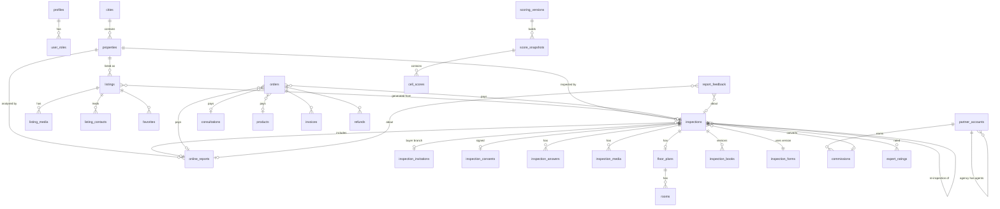
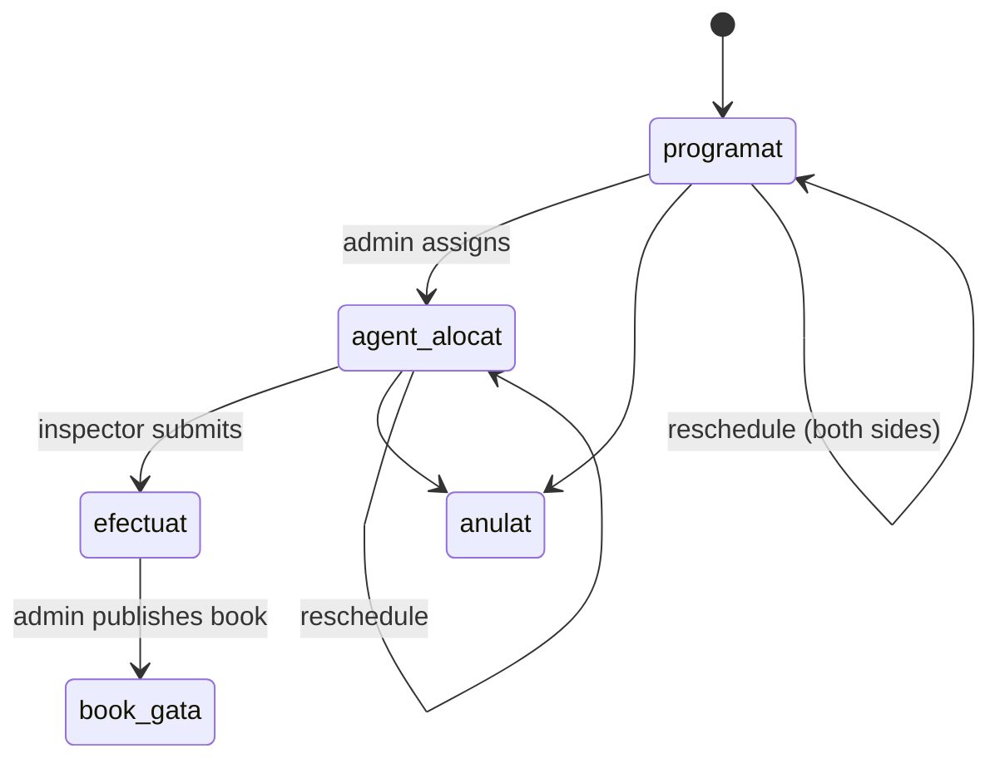
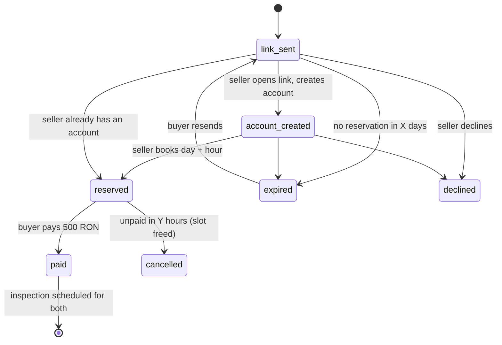
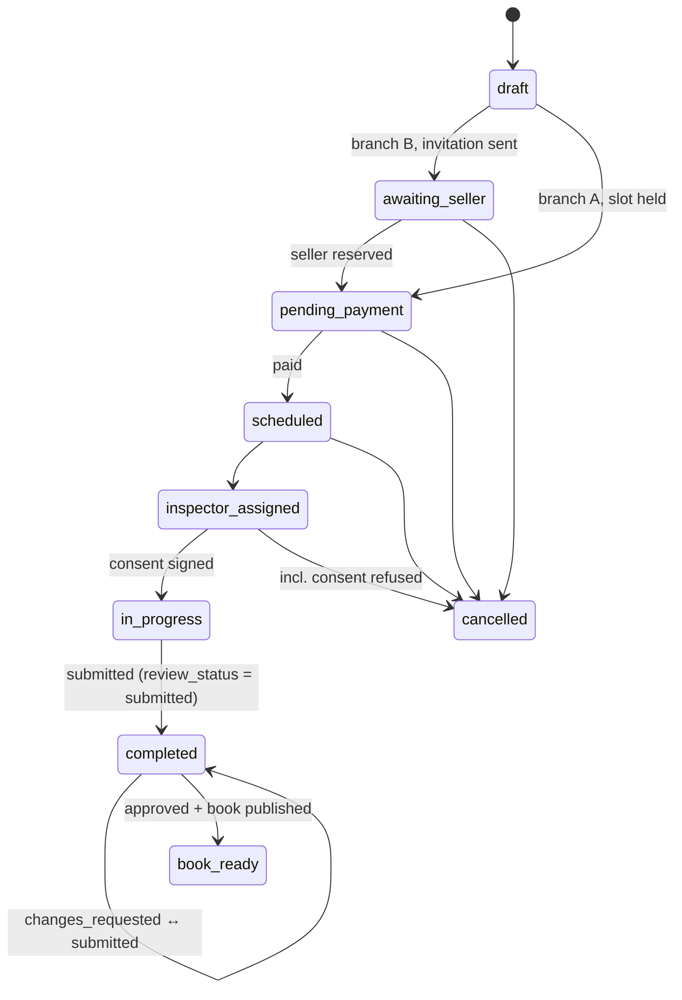
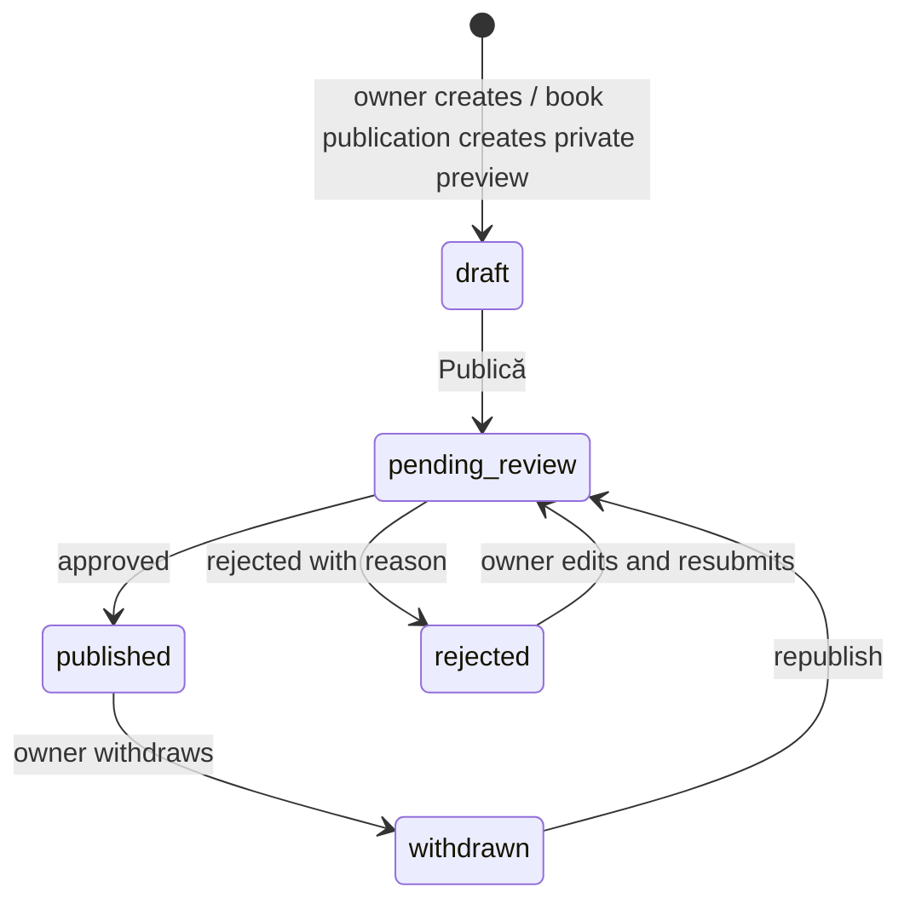
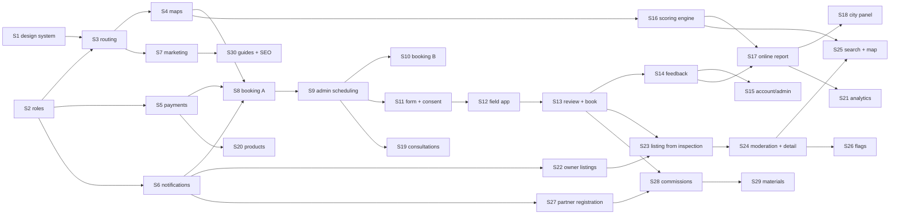

# Property Score: implementation plan

Source: the product roadmap "Harta PropertyScore" (working version of 28 September 2026), restructured into one buildable specification. `CLAUDE.md` and `.claude/rules/` still decide _how_ code is written; this file decides _what_ is built.

**How to read it**

| You are…                          | Read                                                                                              |
| --------------------------------- | ------------------------------------------------------------------------------------------------- |
| Designing screens (Claude Design) | `CLAUDE_DESIGN_PLAN.md` (prompts in order, no backend details); keep it in sync with §5 and §6    |
| Building the database (Supabase)  | §1, §2 roles, §7 data model, §8 state machines, §9 business rules                                 |
| Planning the work                 | §10 implementation order (design batches, build steps, page lookup, progress), §11 open decisions |

**Markers used in this document**

- `[P]` the roadmap marks this as a _proposal_: build it, but expect it may change.
- `[A]` _added by this plan_ to make the spec buildable (a gap in the roadmap). Validate with the product owner.
- `[D]` _added from an approved design_ during implementation (UI-only additions; see `.claude/skills/implement`).
- `F1`–`F4` the delivery phase from the roadmap; `S1`–`S30` the build step (§10.3).

---

## 1. The product in one page

### 1.1 What PropertyScore sells

| Product                                                          | Price                                               | Who buys                                                               | What it is                                                                                                                                                                                                                                                                                                     | Phase |
| ---------------------------------------------------------------- | --------------------------------------------------- | ---------------------------------------------------------------------- | -------------------------------------------------------------------------------------------------------------------------------------------------------------------------------------------------------------------------------------------------------------------------------------------------------------- | ----- |
| **Online report** ("Raport online", product name **SmartCheck**) | 30 RON                                              | Anyone, on any address, including listings on other sites; renters too | Algorithmic report on the _area_, from real geo data: 6 category scores, safety score, neighbourhood rent and asking-price averages, €/m², amenities, walking routes. Never claims anything about the dwelling's condition.                                                                                    | F2    |
| **Physical inspection** ("Inspecție fizică")                     | 500 RON                                             | The owner (seller), or a buyer with the owner's agreement              | An inspector visits, answers a ~44-question form with photos/videos, takes 10 presentation photos, one 360° panorama per room and a Polycam 2D floor plan. Delivers a PDF **book** with a 0–10 score, the **full online report included**, and for the owner a **free professional listing** ready to publish. | F1    |
| **Consultation** ("Consultanță")                                 | to decide, `[P]` 150 RON / 30 min, 250 RON / 60 min | Buyers, sellers                                                        | Video or phone session with an expert: interpreting a book, what to check at a viewing, negotiation, area comparison.                                                                                                                                                                                          | F2    |
| **Digital products** ("Produse digitale")                        | per product                                         | Anyone                                                                 | Instant-download files: interior designs, house plans, buying guides, viewing checklists.                                                                                                                                                                                                                      | F2    |
| **Partner programme**                                            | pays out 100 RON                                    | Real-estate agencies and agents                                        | A partner who brings a seller that completes and pays a physical inspection earns 100 RON of the 500.                                                                                                                                                                                                          | F4    |
| **Listings portal**                                              | free to publish                                     | Owners                                                                 | Sale and rental listings on a list and a map, with or without a PropertyScore report; the badge shows which.                                                                                                                                                                                                   | F3    |

**Coverage.** The online report works in 9 cities: Timișoara, București, Cluj-Napoca, Iași, Constanța, Craiova, Sibiu, Oradea, Târgu Mureș. Physical inspections, consultations and partners start only in cities with a field team (which ones at launch: open, §11). Addresses outside coverage are told so **before** payment.

**Languages.** Romanian is the default, English is the second language everywhere (see §3.3 for URLs). Emails, SMS, the online report PDF and the book follow the account language.

### 1.2 Glossary (use these exact terms in code and designs)

The roadmap uses "agent" for two different people. This plan never does.

| Term in this plan  | Roadmap term                                                  | Meaning                                                                                                                                                               | Code name                                           |
| ------------------ | ------------------------------------------------------------- | --------------------------------------------------------------------------------------------------------------------------------------------------------------------- | --------------------------------------------------- |
| **Inspector**      | "agent", "agent PropertyScore", "arhitect", "expert de teren" | PropertyScore staff member who performs the physical inspection with the field app                                                                                    | role `inspector`, routes `/field/*`                 |
| **Partner**        | "partener"                                                    | A real-estate agency or real-estate agent in the commission programme                                                                                                 | `partner_accounts`                                  |
| **Partner agent**  | "agent imobiliar", "agent în agenție", "agent solo"           | A real-estate agent who is a partner (solo or inside an agency)                                                                                                       | `partner_accounts.kind = agency_agent / solo_agent` |
| **Expert**         | "expert" (consultation)                                       | Staff member who runs consultations                                                                                                                                   | role `expert`                                       |
| **Admin**          | "admin", "echipa PropertyScore"                               | Internal team: scheduling, review, moderation, payments                                                                                                               | role `admin`                                        |
| **Owner / seller** | "proprietar", "vânzător"                                      | Owns the dwelling; the only one who can publish its listing                                                                                                           | `inspections.seller_id`, `listings.owner_id`        |
| **Buyer**          | "cumpărător"                                                  | Wants to buy/rent; may order an online report or request an inspection                                                                                                | `inspections.buyer_id`                              |
| **Book**           | "book", "raport fizic"                                        | The PDF deliverable of a physical inspection, versioned                                                                                                               | `inspection_books`                                  |
| **Online report**  | "raport online"                                               | The 30 RON area report (also embedded in every book)                                                                                                                  | `online_reports`                                    |
| **Badge**          | "badge"                                                       | Public marker on a listing: **physical** (green, "Verificat de PropertyScore"), **online** (blue, with the 0–100 score), **none** (grey, "Fără raport PropertyScore") | derived, §9.4                                       |
| **Invitation**     | "invitație", "link de acord"                                  | Link a buyer sends to a seller so the seller books the inspection slot                                                                                                | `inspection_invitations`                            |
| **Snapshot**       | "snapshot lunar"                                              | Monthly precomputed table of area scores per hex cell; every report reads from one                                                                                    | `score_snapshots`                                   |

### 1.3 Two score scales (designers: never mix them)

- **Online score: 0–100**, integer (e.g. "91", safety "74 / 100"). Blue.
- **Physical (inspection) score: 0–10**, one decimal, Romanian comma (e.g. "8,6 / 10"). Green.

---

## 2. Roles and access zones

| Zone        | URL root                                                  | Who                                                     | How the role is obtained                                                                               | Shell                                 |
| ----------- | --------------------------------------------------------- | ------------------------------------------------------- | ------------------------------------------------------------------------------------------------------ | ------------------------------------- |
| Public site | `/` and `/en/`                                            | Everyone, signed in or not                              | —                                                                                                      | Site header + footer                  |
| Auth        | `/login`, `/sign-up`, `/reset-password`, `/auth/callback` | Signed-out users                                        | —                                                                                                      | Centered layout (exists)              |
| Account     | `/account/*`                                              | Any signed-in user (buyer, seller, client)              | Sign-up, or created automatically at checkout                                                          | Account shell: header + section tabs  |
| Partner     | `/partner/*`                                              | Users with an **active** `partner_accounts` row         | Registration on `/partners` + approval (admin for agencies and solo agents, the agency for its agents) | Partner shell                         |
| Field app   | `/field/*`                                                | Role `inspector`                                        | Assigned by admin in `/admin/users`                                                                    | Mobile-only shell, PWA, works offline |
| Admin       | `/admin/*`                                                | Role `admin` (role `expert` sees only its own calendar) | Assigned by admin; first admin via `seed.sql` / SQL                                                    | Admin shell with sidebar              |

A person can hold several: an inspector can also be a buyer; a partner agent is also a normal account. Roles come from `user_roles` and are put in the JWT by the Custom Access Token Hook (SETUP_PLAN §9). Partner status is read from `partner_accounts`, also exposed as a claim. **All UI checks are UX only; RLS enforces everything (§7.12).**

---

## 3. Routing

### 3.1 URL naming

The project rule is _URL segments in English, kebab-case_. The roadmap proposes Romanian slugs (`/anunturi`). Both are listed below so either decision works; **this plan builds the English paths** (rule wins) unless decision D1 (§11) changes it. Designers can show either; copy on the page is Romanian by default anyway.

### 3.2 Layout tree (TanStack Router, file-based)

```
src/routes/
├── __root.tsx                          head, providers, Outlet
├── {-$locale}/                         optional "en" segment: RO at /…, EN at /en/…
│   ├── route.tsx                       SiteLayout: header, footer, validates locale ∈ {en}
│   ├── index.tsx                       /
│   ├── map.tsx                         /map
│   ├── listings/index.tsx              /listings
│   ├── listings/$listingId.tsx         /listings/:id
│   ├── how-it-works.tsx  pricing.tsx  partners.tsx  about.tsx  contact.tsx  faq.tsx
│   ├── guides/index.tsx  guides/$slug.tsx
│   ├── legal/$document.tsx             terms | privacy | cookies
│   ├── check/index.tsx                 online report wizard
│   ├── check/result.$reportId.tsx      online report (owner or share token)
│   ├── inspection/index.tsx            inspection wizard (branch A owner / B buyer)
│   ├── inspection/invitation.$token.tsx
│   ├── inspection/confirmation.$inspectionId.tsx
│   ├── consultation.tsx
│   └── products/index.tsx  products/$slug.tsx
├── _public/                            exists: login, sign-up (+ reset-password, auth/callback)
└── _authenticated/                     exists: guard "signed in"
    ├── account/…                       AccountShell
    ├── partner/…                       guard: active partner (pending → status screen)
    ├── field/…                         guard: role inspector; FieldShell
    └── admin/…                         guard: role admin or expert; AdminShell
```

The existing `_authenticated/index.tsx` placeholder becomes a redirect to `/account`.

### 3.3 Language rules

- **Public pages:** Romanian at `/…`, English at `/en/…`, identical structure. The header switcher swaps the prefix and keeps the page and its search params. Each public page declares its `hreflang` pair. Guides may exist in one language only; the switcher then goes to the guides index.
- **Signed-in zones** (`/account`, `/partner`, `/field`, `/admin`): no prefix; language = `profiles.locale` (already implemented). Changing language on a public page while signed in also updates the profile.
- **Account creation** proposes the language of the page where it happened `[P]`.
- **Seller invitation email** goes out in the seller's language, not the buyer's; the invitation page has its own switcher `[P]`.
- **Admin and field app:** the roadmap says Romanian only; the project rule says every string is bilingual. Build both (cheap with i18next); see D2.
- **Book generation:** same answers, generated in the client's language. Form questions therefore have `prompt_ro` and `prompt_en` (§7.5).

### 3.4 Guards and redirects

| Situation                                                                | Behaviour                                                                                                                 |
| ------------------------------------------------------------------------ | ------------------------------------------------------------------------------------------------------------------------- |
| Signed-out user opens `/account/*`, `/partner/*`, `/field/*`, `/admin/*` | Redirect to `/login?redirect=<url>`                                                                                       |
| Signed-in user opens `/login` or `/sign-up`                              | Redirect to `redirect` param or `/account`                                                                                |
| User without the role opens `/field/*` or `/admin/*`                     | Render the not-found page (do not reveal the zone exists)                                                                 |
| User opens `/partner` with no partner account                            | Redirect to `/partners` (landing with registration)                                                                       |
| Partner account `pending` / `rejected` / `disabled`                      | `/partner` shows a status screen; sub-pages redirect to `/partner`                                                        |
| Partner of kind `agency_agent` or `solo_agent` opens `/partner/agents`   | Not found (agency only)                                                                                                   |
| `/check/result/$reportId`                                                | Owner of the report, admin, or a valid share token (`?share=`); otherwise not found                                       |
| `/inspection/invitation/$token`                                          | Public. Token checked by RPC: valid → page; expired / cancelled / used → explanatory state with "ask the buyer to resend" |
| `/field/inspections/$id` before consent is signed                        | Redirect to `/field/inspections/$id/consent`                                                                              |
| Wizards (`/check`, `/inspection`, `/consultation`, `/products/$slug`)    | Public until the checkout step; checkout asks for email and signs the user in inline (D5), then pays                      |

### 3.5 Search params (validated with Zod in `validateSearch`)

| Route                                                       | Params                                                                                                                                                                                                                                                                                                                                                                                                               |
| ----------------------------------------------------------- | -------------------------------------------------------------------------------------------------------------------------------------------------------------------------------------------------------------------------------------------------------------------------------------------------------------------------------------------------------------------------------------------------------------------- |
| `/listings`, `/map` (same schema, preserved when switching) | `transaction=sale\|rent`, `city`, `neighbourhood`, `type=apartment\|house`, `priceMin`, `priceMax`, `rooms` (1–5+), `areaMin`, `areaMax`, `floorMin`, `floorMax`, `yearMin`, `yearMax`, `report=physical\|online\|none`, `nearSchool` (metres), `nearTram` (bool), `onlineScoreMin`, `sort=relevance\|price_asc\|price_desc\|newest\|score`, `page`, `bbox` (map only), `selected` (listing id of the open map card) |
| `/check`                                                    | `step=address\|confirm\|details\|preview\|checkout`, `listingUrl`                                                                                                                                                                                                                                                                                                                                                    |
| `/inspection`                                               | `branch=owner\|buyer`, `step`, `listing` (listing id), `property` (re-inspection), `partner` (code from referral link)                                                                                                                                                                                                                                                                                               |
| `/consultation`                                             | `step`, `topic`, `inspection` / `report` (preloaded from a book or report)                                                                                                                                                                                                                                                                                                                                           |
| `/check/result/$reportId`                                   | `share` (token)                                                                                                                                                                                                                                                                                                                                                                                                      |
| `/admin/appointments`                                       | `view=day\|week`, `date`, `inspector`                                                                                                                                                                                                                                                                                                                                                                                |
| list pages in account/admin                                 | `status`, `page`, `q`                                                                                                                                                                                                                                                                                                                                                                                                |

Wizard field values live in a Zustand store persisted to `sessionStorage` (Zustand is pre-approved), so a refresh keeps the wizard; only `step` is in the URL.

### 3.6 Navigation per zone

- **Public header** (from the map mockup): logo · Hartă (`/map`) · Anunțuri (`/listings`) · **Verifică · 30 lei** (`/check`, `cta` lime button) · **Inspecție · 500 lei** (`/inspection`, `outline` button) · Consultanță · Produse · Cont / Intră · RO/EN. Mobile: logo, primary CTA, burger.
- **Public footer:** Cum funcționează · Prețuri · Parteneri · Ghiduri · Despre · Contact · FAQ · Termeni · Confidențialitate · Cookies · covered cities.
- **Account tabs:** Prezentare (`/account`) · Rapoarte · Programări · Cereri · Anunțuri · Favorite · Produse · Facturi · Setări. Badge counts on Cereri (awaiting action) and Rapoarte (new replies).
- **Partner:** Panou · Client nou · Clienți · Comisioane · Materiale · Agenți (agency only).
- **Field app:** Agenda zilei · Istoric; inside an inspection: sticky progress header.
- **Admin sidebar:** Panou · Programări · Inspecții · Anunțuri · Feedback `[A]` · Utilizatori · Parteneri · Plăți · Scoring · Analytics · Produse · Conținut `[A]`.

### 3.7 Complete route table

57 rows: the roadmap's 49 page cards (with `/despre /contact /faq` split into three), the 4 auth pages, and 2 `[A]` detail routes.

| #   | App path                                        | Roadmap URL                          | Zone / access                | Phase | Feature module     |
| --- | ----------------------------------------------- | ------------------------------------ | ---------------------------- | ----- | ------------------ |
| 1   | `/`                                             | `/`                                  | public                       | F1    | `marketing`        |
| 2   | `/map`                                          | `/harta`                             | public                       | F3    | `listings`         |
| 3   | `/listings`                                     | `/anunturi`                          | public                       | F3    | `listings`         |
| 4   | `/listings/$listingId`                          | `/anunturi/[id]`                     | public                       | F3    | `listings`         |
| 5   | `/how-it-works`                                 | `/cum-functioneaza`                  | public                       | F1    | `marketing`        |
| 6   | `/pricing`                                      | `/preturi`                           | public                       | F1    | `marketing`        |
| 7   | `/partners`                                     | `/parteneri`                         | public                       | F4    | `partners`         |
| 8   | `/guides`, `/guides/$slug`                      | `/ghiduri`                           | public                       | F4    | `guides`           |
| 9   | `/about`                                        | `/despre`                            | public                       | F1*   | `marketing`        |
| 10  | `/contact`                                      | `/contact`                           | public                       | F1*   | `marketing`        |
| 11  | `/faq`                                          | `/faq`                               | public                       | F1*   | `marketing`        |
| 12  | `/legal/$document`                              | `/legal/*`                           | public                       | F1*   | `marketing`        |
| 13  | `/check`                                        | `/verifica`                          | public → sign-in at checkout | F2    | `online-reports`   |
| 14  | `/check/result/$reportId`                       | `/verifica/rezultat/[id]`            | owner / share token          | F2    | `online-reports`   |
| 15  | `/inspection`                                   | `/inspectie`                         | public → sign-in at checkout | F1    | `inspections`      |
| 16  | `/inspection/invitation/$token`                 | `/inspectie/invitatie/[token]`       | token                        | F1    | `inspections`      |
| 17  | `/inspection/confirmation/$inspectionId`        | `/inspectie/confirmare/[id]`         | party of the inspection      | F1    | `inspections`      |
| 18  | `/consultation`                                 | `/consultanta`                       | public → sign-in at checkout | F2*   | `consultations`    |
| 19  | `/products`                                     | `/produse`                           | public                       | F2*   | `products`         |
| 20  | `/products/$slug`                               | `/produse/[slug]`                    | public → sign-in at checkout | F2*   | `products`         |
| 21  | `/login`                                        | —                                    | signed out                   | done  | `auth`             |
| 22  | `/sign-up`                                      | —                                    | signed out                   | done  | `auth`             |
| 23  | `/reset-password`                               | —                                    | signed out                   | F1    | `auth`             |
| 24  | `/auth/callback`                                | —                                    | any                          | F1    | `auth`             |
| 25  | `/account`                                      | `/cont`                              | signed in                    | F1*   | `account`          |
| 26  | `/account/reports`                              | `/cont/rapoarte`                     | signed in                    | F1    | `reports`          |
| 27  | `/account/reports/$inspectionId` `[A]`          | (inside `/cont/rapoarte`)            | party of the inspection      | F1    | `reports`          |
| 28  | `/account/appointments`                         | `/cont/programari`                   | signed in                    | F1*   | `inspections`      |
| 29  | `/account/requests`                             | `/cont/cereri`                       | signed in                    | F1*   | `inspections`      |
| 30  | `/account/listings`                             | `/cont/anunturi`                     | signed in                    | F3    | `listings`         |
| 31  | `/account/listings/new`                         | `/cont/anunturi/nou`                 | signed in                    | F3    | `listings`         |
| 32  | `/account/listings/$listingId`                  | `/cont/anunturi/[id]`                | listing owner                | F3    | `listings`         |
| 33  | `/account/favorites`                            | `/cont/favorite`                     | signed in                    | F3    | `listings`         |
| 34  | `/account/invoices`                             | `/cont/facturi`                      | signed in                    | F1*   | `orders`           |
| 35  | `/account/settings`                             | `/cont/setari`                       | signed in                    | F1*   | `profile`          |
| 36  | `/account/products`                             | `/cont/produse`                      | signed in                    | F2*   | `products`         |
| 37  | `/partner`                                      | `/partener`                          | active partner               | F4    | `partners`         |
| 38  | `/partner/new-lead`                             | `/partener/lead-nou`                 | active partner               | F4    | `partners`         |
| 39  | `/partner/clients`                              | `/partener/clienti`                  | active partner               | F4    | `partners`         |
| 40  | `/partner/commissions`                          | `/partener/comisioane`               | active partner               | F4    | `partners`         |
| 41  | `/partner/materials`                            | `/partener/materiale`                | active partner               | F4    | `partners`         |
| 42  | `/partner/agents`                               | `/partener/agenti`                   | active agency                | F4    | `partners`         |
| 43  | `/field`                                        | `/agent`                             | inspector                    | F1    | `field-inspection` |
| 44  | `/field/inspections/$inspectionId/consent`      | `/agent/inspectie/[id]/consimtamant` | assigned inspector           | F1    | `field-inspection` |
| 45  | `/field/inspections/$inspectionId`              | `/agent/inspectie/[id]`              | assigned inspector           | F1    | `field-inspection` |
| 46  | `/field/history`                                | `/agent/istoric`                     | inspector                    | F1*   | `field-inspection` |
| 47  | `/admin`                                        | `/admin`                             | admin                        | F1*   | `admin`            |
| 48  | `/admin/appointments`                           | `/admin/programari`                  | admin, expert (own)          | F1    | `scheduling`       |
| 49  | `/admin/inspections` (+ `/$inspectionId` `[A]`) | `/admin/inspectii`                   | admin                        | F1    | `inspections`      |
| 50  | `/admin/listings`                               | `/admin/anunturi`                    | admin                        | F3*   | `listings`         |
| 51  | `/admin/feedback` (+ `/$feedbackId`) `[A]`      | section of `/admin`                  | admin                        | F1    | `feedback`         |
| 52  | `/admin/users`                                  | `/admin/utilizatori`                 | admin                        | F1*   | `admin`            |
| 53  | `/admin/partners`                               | `/admin/parteneri`                   | admin                        | F4*   | `partners`         |
| 54  | `/admin/payments`                               | `/admin/plati`                       | admin                        | F1*   | `orders`           |
| 55  | `/admin/scoring`                                | `/admin/scoring`                     | admin                        | F2    | `scoring`          |
| 56  | `/admin/analytics`                              | `/admin/rapoarte`                    | admin                        | F2*   | `admin`            |
| 57  | `/admin/products`                               | `/admin/produse`                     | admin                        | F2*   | `products`         |

`*` = the roadmap does not assign the phase explicitly. `/admin/rapoarte` is renamed **analytics** so it is never confused with customer reports.

---

## 4. User flows, step by step

Each step: **who · page · what happens · data written · status after**. Colours from the roadmap: amber = payment, blue = email/SMS, green = deliverable.

### Flow 1 · Online report, 30 RON (F2)

1. Visitor · `/`, `/pricing`, `/how-it-works` · clicks "Verifică o proprietate, 30 lei" → `/check`.
2. Visitor · `/check` step _address_ · types an address (autocomplete) or pastes a listing URL (imobiliare.ro, OLX, Storia). Outside the 9 cities → clear message, no checkout.
3. Visitor · step _confirm_ · map with pin, "Asta e proprietatea?", can drag the pin.
4. Visitor · step _details_ (optional, skippable) · the 7 questions (§5.13). Prefilled from the listing URL when extractable; user confirms.
5. Visitor · step _preview_ · free: overall score + 1–2 categories unlocked, the rest blurred. Served by Edge Function `online-report-preview` (nothing stored, nothing locked leaks).
6. Visitor · step _checkout_ · email → inline sign-in/creation (D5) → card / Apple Pay / Google Pay. **Writes:** `properties` (or reuse), `online_reports` (status `pending_payment`), `orders` (`pending`).
7. System · payment webhook → `orders.paid`, report generated from the current snapshot and frozen (`online_reports.ready`), PDF rendered, email sent (blue), notification.
8. User · `/check/result/$reportId` · full report; also in `/account/reports`; PDF download; at the end "Semnalează o problemă sau o sugestie" (Flow 5).
9. User · mandatory upsell under the report: "Vrei să știi și în ce stare e efectiv? Inspecție fizică, 500 lei" → Flow 2A or 2B, address prefilled.

### Flow 2A · Physical inspection, I am the owner (F1)

1. Seller · `/`, `/pricing`, or own listing "Comandă PropertyScore pentru acest anunț" → `/inspection?branch=owner`.
2. Seller · _property_: address, type, area, year, floor. Re-inspection entry `[P]`: from a previous book, property prefilled + "reason for redoing".
3. Seller · _slot_: calendar of real team availability (`available_slots` RPC).
4. Seller · _access_: who opens, phone, notes.
5. Seller · _checkout_ 500 RON: summary lists everything included (online report, presentation photos, 360° per room, Polycam plan, free professional listing); optional "cod partener". **Writes:** `inspections` (`pending_payment`, slot held), `orders`.
6. System · payment → inspection `scheduled`; `/inspection/confirmation/$id`; email "how to prepare" (blue); appears in `/account/appointments`.
7. Admin · `/admin/appointments` · drags the appointment onto an inspector → `inspector_assigned`.
8. Inspector + seller · `/field/inspections/$id/consent` · seller signs on the inspector's phone (3 ticks + finger signature). Signed PDF emailed to seller and stored. Refusal → inspection `cancelled` with reason `consent_refused`, admin notified.
9. Inspector · `/field/inspections/$id` · questionnaire, required media, notes, measurements; live provisional score; 10 presentation shots; one 360° panorama per room; Polycam scan; room naming. Works offline, syncs later. Owner confirms completion → `completed` ("efectuat"), `review_status = submitted`.
10. Admin · `/admin/inspections/$id` · reviews answers with media, category scores and calculation, plan and panorama ↔ room mapping; may send back to inspector (`changes_requested`); approves → book PDF generated and published → `book_ready` (green). Online report for the address generated and attached to the book.
11. Seller · `/account/reports/$id` · book visible, PDF download, share link with expiry, "Spune-ne cum a fost" (Flow 5).
12. System · at book publication: a **private listing draft** is created (`source = inspection`) with photos, plan, panoramas, LLM description, both reports' publishable content.
13. Seller · `/account/listings/$id` · 1:1 preview; picks photos/rooms, edits description/price/title/phone; the PropertyScore block is locked. "Publică" → moderation (Flow 6).
14. If a partner code was used: once the inspection is completed **and** paid, a commission of 100 RON is earned (Flow 4).

### Flow 2B · Physical inspection, I am the buyer (F1)

1. Buyer and seller agree outside the site (phone, viewing).
2. Buyer · "Cere PropertyScore pentru această proprietate" on a listing, or `/inspection?branch=buyer` with an address. Needs an account (created inline).
3. Buyer · site generates the invitation link; sends it by email or SMS from the site, or copies it (WhatsApp). **Writes:** `inspections` (`awaiting_seller`), `inspection_invitations` (`link_sent`). Shows in `/account/requests`.
4. Seller · `/inspection/invitation/$token` · sees who asks, for which property, what it involves, that it costs them nothing; creates an account (email, phone, password) → `account_created`.
5. Seller · books day/hour (they must open the door) + access details → invitation `reserved`, inspection `pending_payment`, slot held for Y hours.
6. System → buyer · in-site + email + SMS: "vânzătorul a rezervat pentru [zi], ora [oră]; plătește ca să confirmi", link straight to payment.
7. Buyer · pays 500 RON → invitation `paid`, inspection `scheduled`, appears in both accounts' appointments, confirmation email to both, "how to prepare" to the seller.
8. Steps 7–10 of Flow 2A, identical.
9. Buyer and seller · both receive the book. Both can report problems; only the person present at the visit rates the inspector.
10. Seller only · may publish the free listing. The buyer can never publish anything.

Timeouts `[P]`: no reservation within **X days** → invitation `expired` (buyer can resend); not paid within **Y hours** of reservation → `cancelled`, slot released, both notified. Seller can decline with a short message `[P]`.

### Flow 3 · Listings portal (F3)

1. Owner · `/account/listings/new` · sale or rent, photos, description, features, address + pin, price or monthly rent. No report required.
2. Owner · submits → `pending_review`. Admin · `/admin/listings` approves (or rejects with reason).
3. Public · `/listings/$id` · published with badge **none**, or **online** (if an online report is attached: score, breakdown, honest message "scorul online nu poate vedea starea reală a locuinței" + CTA to inspection).
4. Buyer · `/map` and `/listings` · pins coloured by badge; filters incl. "Doar cu PropertyScore verificat" and "la max. 500 m de școală"; saves a search with alert; contacts the seller (measured lead); mortgage calculator.
5. Owner · `/account/listings` · stats (views, favourites, contacts), "Comandă PropertyScore pentru acest anunț" → Flow 2A.
6. After an inspection: badge toggle; the listing rises in "verified only" and score sorting.

### Flow 4 · Partner programme (F4)

1. Partner · `/` block "Ești agent? Câștigă 100 lei per proprietate" → `/partners` (calculator, rules).
2. Registration, three variants: **agency** (company, billing, who collects commissions) → admin approval → agency code; **agent in an agency** (enters agency code) → agency approves in `/partner/agents` → own commission code; **solo agent** (person or PFA, billing) → admin approval → commission code.
3. Partner · `/partner` · big copyable commission code + referral link, recent clients, totals.
4. Attribution: partner sends a seller from `/partner/new-lead` (invitation carries the code), **or** the client enters the code at `/inspection` checkout.
5. Partner · `/partner/clients` · stages: code used → scheduled → inspector assigned → done → book ready → commission paid. When the book is published the partner sees score, verdict and PDF.
6. Admin · `/admin/partners` · conversion counted when the inspection is completed and paid; pays 100 RON to the agency or the agent (agency setting; solo always the agent).

### Flow 5 · Feedback after delivery (online F2, physical F1)

1. Client · delivery notification and end of report: "Spune-ne cum a fost".
2. Two independent optional actions: **Rate the inspector** (physical only, 1–5 + optional comment, one per client per inspection, only for someone who attended) and **Report a problem or suggestion** (any report: _Date incorecte_ / _Informații lipsă_ / _Sugestie de îmbunătățire_, section or finding, description, optional photo or source; report version attached automatically).
3. System · confirmation "Am primit observația ta", reference number, status _Trimis_.
4. Admin · `/admin/feedback` · groups ratings and report issues; may ask the inspector for clarification; status _În analiză_.
5. Team → client · answer in the account + notification. Confirmed error → **new report version** with date and change list; old version kept. No correction needed → reason given. Status _Rezolvat_ or _Închis cu explicație_.
6. Feedback never edits a report or a score automatically and is never published as a public review.

### Flow 6 · Listing publication and moderation (F3)

1. Owner clicks "Publică" → `pending_review`.
2. Admin checks content; for inspected listings also the public plan and selected panoramas (no people, documents, personal items) → `published` (selected media copied to the public bucket) or `rejected` with reason.
3. Owner can withdraw any time → `withdrawn` (public media removed); edits to a published listing `[P]` go back through moderation only for photos/description changes (D13).

### Flow 7 · Consultation (F2)

1. Client · "Vorbește cu un expert" (`/`, `/pricing`) or "Discută book-ul cu un expert" from a book (property preloaded) → `/consultation`.
2. Topic (book interpretation / what to check at a viewing / negotiation / area comparison), duration 30 or 60 min, slot from experts' calendar, checkout.
3. Confirmation email with meeting link; appears in `/account/appointments` with reschedule and cancel.
4. Expert marks it done in `/admin/appointments`; optional written summary next to the book `[P]`.

### Flow 8 · Digital products (F2)

`/products` → `/products/$slug` → checkout → instant download in `/account/products` + email link. Admin manages catalogue in `/admin/products`.

---

## 5. Page specifications

Format for every page: **Purpose · Layout (top → bottom) · Data · Actions · States · Links out**. Romanian copy in quotes is the roadmap's wording and is the source text (EN is translated).

### 5.1 Public site

#### `/` Home · F1

- **Purpose:** explain the two roles of PropertyScore (verification services + listings portal) and push to the two CTAs.
- **Layout:**
  1. Header (§3.6).
  2. Hero, two columns (mobile: stacked in this order): left "Află mai multe despre locuință, înainte să faci următorul pas." + address input "Unde este proprietatea?" + `cta` button "Verifică proprietatea 30 lei" + hint "Poți începe doar cu adresa." + secondary link "Vrei și o inspecție la fața locului? 500 lei". Right: demo report card ("Date demonstrative") with declared details, nearby transport/park/school minutes, a "De întrebat la vizionare" item. Covered cities stated in the hero.
  3. Listings search bar: locality, type, price; links to `/listings` and `/map`.
  4. Message: owners can publish their own listing for free without buying a report; the professional listing is a benefit included in the 500 RON package.
  5. What the 500 RON package includes (online report, presentation photos, 360° per room, Polycam plan, free professional listing).
  6. Badge explainer: listing with vs. without PropertyScore (3 states).
  7. Carousel of listings with a physical badge.
  8. "Cum funcționează" in 3 steps.
  9. Online vs physical short comparison → `/how-it-works`.
  10. Trust numbers: inspections done, inspectors, cities.
  11. Partner block "Ești agent? Câștigă 100 lei per proprietate" → `/partners`.
  12. Consultation and products teasers.
- **Data:** published listings with physical badge (carousel), public stats `[A]` (`public_stats` view), cities.
- **Actions:** start `/check` with the typed address; search → `/listings?…`.
- **Links:** `/map`, `/listings`, `/check`, `/inspection`, `/consultation`, `/products`, `/how-it-works`, `/pricing`, `/partners`.

#### `/map` All listings on a map · F3

- **Purpose:** every active listing on one map; the badge is visible before any click.
- **Layout:** full-screen map; top bar with Cumpărare / Închiriere toggle (kept when switching to list), quick filter chips "Toate · Verificate fizic · Cu scor online · Fără PropertyScore", count line ("20 locuințe afișate · 5 verificate fizic · 7 cu scor online · 8 fără"), filter drawer (same filters as `/listings`) `[P]`, map/list switch `[P]`; legend.
- **Pins:** green (physical), blue with the online score number, grey (none). Hover → price. Clusters at low zoom with number of verified inside `[P]`.
- **Pin click → card:** photo, price, area, rooms, PropertyScore block variant; "Vezi anunțul"; on grey/blue pins also "Cere PropertyScore" and "Verifică zona, 30 lei". Missing report is never presented as a defect.
- **Data:** `search_listings` RPC with `bbox` → pins (id, approx point, price, badge, online score).
- **States:** loading tiles, no results in area ("Mută harta sau schimbă filtrele"), outside coverage.
- **Links:** `/listings/$id`, `/listings`, `/inspection`, `/check`.

#### `/listings` Search · F3

- **Layout:** list + map side by side (mobile: list with a "Hartă" toggle), synchronised: hovering a card highlights the pin.
- **Filters:** sale/rent, price (sale price or monthly rent), area, rooms, floor, construction year, type, city/neighbourhood; **star filter "Doar cu PropertyScore verificat" visible, not under "more filters"**; derived filters "la max. 500 m de școală", "aproape de linie de tramvai", "scor online peste X"; draw custom area on map (nice-to-have).
- **Sort:** relevance, price, newest, PropertyScore score.
- **Card:** photo, price, area/rooms, area name, badge + online score. Inspection-generated listings open the full professional presentation.
- **Actions:** save search with email alert (signed in; else sign-in prompt), favourite.
- **States:** empty results, loading skeleton cards, pagination.
- **Links:** `/listings/$id`, `/map`, `/account/favorites`.

#### `/listings/$listingId` Listing detail · F3 — the most important page

- **Layout:**
  1. Gallery (presentation photos, optional video tour); photos from the inspector labelled "tur foto agent" only in the owner preview.
  2. Header: "De vânzare" / "De închiriat", total price or rent per month, area, rooms, floor, **approximate** address, favourite, share.
  3. **Floor plan + 360° tour** (inspected listings only): 2D Polycam plan with selectable rooms; click a room or its hotspot → animated transition into its panorama; look around; back to plan or jump to another room. Rooms without a usable panorama show on the plan without an active point. Respects reduced motion (cross-fade instead of zoom).
  4. **PropertyScore block** (centrepiece), one of four variants:
     - _Physical:_ green badge "Verificat de PropertyScore", score "8,6 / 10", date, inspector, validity, 10–11 category scores, verdict, publishable findings, plus the full online report content (6 categories, safety, rent and asking-price averages, €/m², amenities, route map). Private inspection documents never appear.
     - _Physical, older than 12 months:_ same + "reinspecție recomandată" `[P]`.
     - _Online only:_ blue score 0–100 with breakdown + "Scorul online nu poate vedea starea reală a locuinței. Cere o inspecție fizică." + CTA.
     - _None:_ grey label "Fără raport PropertyScore" + CTAs "Cere PropertyScore" and "Verifică zona, 30 lei".
  5. Description and features from the seller (label "generată din inspecție" or "editată de proprietar").
  6. Map and neighbourhood: POIs, walking times, transport lines.
  7. Contact: form, phone revealed on click (both logged as leads).
  8. Mortgage calculator (down payment, years, IRCC/Euribor rate → monthly payment).
  9. Similar listings; price history if changed.
  10. For non-owners: "Cere PropertyScore pentru această proprietate".
- **Data:** `get_public_listing(id)` RPC (only published content), `record_listing_view` on mount.
- **Actions:** favourite, share, reveal phone (`reveal_listing_phone` RPC), send message (`listing_contacts`), request inspection (`/inspection?branch=buyer&listing=id`), report listing `[P]`.
- **States:** withdrawn or rejected → "Anunțul nu mai este disponibil" + similar listings; not found.

#### `/how-it-works` · F1

Table "ce include fiecare" (online vs physical 500 RON), what the online report cannot know and why the physical can, anonymised real book example, how an inspection goes (duration, what is checked, when the book arrives) `[P]`, the free professional listing for owners, CTAs to both products. Links `/pricing`, `/check`, `/inspection`.

#### `/pricing` · F1

Cards: online 30 RON (self-service, anyone, any property) · physical 500 RON (paid by owner, or by buyer with owner's agreement; inclusions listed **next to the price** and repeated in the order summary) · partner programme 100 RON per conversion · consultation (price TBD) · digital products. Coverage. Refund policy on cancellation `[P]`. Links `/how-it-works`, `/check`, `/inspection`, `/consultation`, `/products`, `/partners`.

#### `/partners` Partner landing · F4

Explanation (bring a seller → 100 of 500 RON), calculator "5 proprietăți pe lună = 500 lei", rules (conversion = inspection completed and paid; when and how payouts happen; agency chooses who collects), what the partner sees. **Registration form with three variants** (agency / agent in agency with agency code / solo agent); fields in §7.8. After submit: "în așteptarea aprobării" state. Links `/partner`.

#### `/guides`, `/guides/$slug` · F4

Index with filters (city, topic); article page with CTA to `/check` or `/inspection` at the end `[P]`; neighbourhood guides generated from the same data as the online score `[P]`; city comparisons (Numbeo, with attribution).

#### `/about`, `/contact`, `/faq` · F1*

About: team, inspectors, cities, numbers `[P]`. Contact: form (→ `contact_messages`), phone, hours `[P]`. FAQ: online vs physical, duration, who pays in the buyer flow, refund, "what if the book misses a defect" `[P]`.

#### `/legal/$document` · F1*

`terms`, `privacy`, `cookies`; book disclaimer and liability insurance note `[P]`; cancellation and refund policy (same as in appointments) `[P]`. Static content in both languages.

### 5.2 Public wizards

#### `/check` Online report wizard · F2

- **Step 1 Address:** autocomplete or listing URL. Out of coverage → stop with message.
- **Step 2 Confirm:** map with pin, "Asta e proprietatea?", drag to adjust.
- **Step 3 Details (optional):** intro "Completează ce știi din anunț sau din discuția cu vânzătorul. Poți continua și fără aceste detalii." Questions, all optional, each with "Nu știu":
  | Question                                                                          | Input                                                                         |
  | --------------------------------------------------------------------------------- | ----------------------------------------------------------------------------- |
  | Câte camere și aproximativ câți m² are?                                           | two independent number fields                                                 |
  | La ce etaj este? Câte etaje are blocul?                                           | "3 din 8"; floor alone allowed                                                |
  | Blocul are lift?                                                                  | Da / Nu / Nu știu                                                             |
  | Ce știe despre parcare?                                                           | Loc inclus / Loc disponibil separat / Doar pe stradă / Fără parcare / Nu știu |
  | Cam când a fost construit blocul?                                                 | exact year or period / Nu știu                                                |
  | Ce încălzire are?                                                                 | Centrală proprie / A blocului / Termoficare / Altceva / Nu știu               |
  | "Nu știu" never lowers the score; answers are shown as "declarate" in the report. |
- **Step 4 Preview:** overall score + 1–2 unlocked categories, others blurred with lock; "calculat pe datele din …, v3".
- **Step 5 Checkout:** email → sign-in, payment methods, 30 RON, terms tick.
- **Data:** `geocode-address`, `parse-listing-url`, `online-report-preview`, `create-checkout` Edge Functions.
- **States:** geocoding failed, address ambiguous (pick from list), payment failed (retry), payment pending.

#### `/check/result/$reportId` Online report · F2

- **Layout:** header (address, date, "calculat pe datele din 1 sept 2026, formula v3", PDF, share); overall score; six categories each with its score: Educație · Sănătate · Transport · Cumpărături & servicii (incl. **non-stop shops** with distance and opening-hours source, "program necunoscut" when missing) · Spații verzi · Siguranță & liniște; **safety block** (74/100, four layers each with value, source and date on hover, POI list with distances, police zone, disclaimer "Indicator de proximitate și percepție…", never the words "periculos"/"sigur"); neighbourhood rent average, asking-price average, €/m² (source, period, area); amenities and walking-routes map (isochrones, real walking distances); **building block** (year and where the info came from, "necunoscut" allowed, what still needs checking; no safe/unsafe verdict); declared answers marked "declarate"; "Orașul în cifre" panel (Numbeo, city-level, with attribution, no safety) `[P]`; transparency: sources and weights; what this report cannot know; **upsell** to physical inspection (mandatory); "Semnalează o problemă sau o sugestie".
- **Data:** `online_reports` row (frozen `result`), signed PDF URL.
- **States:** generating (spinner, auto-refresh), failed (support message), revised version available.

#### `/inspection` Inspection wizard · F1

- **Step 0 Branch:** "Sunt proprietar" / "Sunt cumpărător" (skipped when `branch` is in the URL).
- **Branch A (owner):** property (address + pin, type apartment/house, area, year, floor) → slot (calendar of real availability) → access (who opens, phone, notes) → checkout 500 RON (inclusions list, optional "cod partener" validated live) → `/inspection/confirmation/$id`.
- **Branch B (buyer):** property (pick a PropertyScore listing or type address) → account (inline) → invitation (send by email / SMS from the site, or copy link) → done screen "Ți-am trimis linkul… Te anunțăm când vânzătorul rezervă" → status lives in `/account/requests`.
- **Re-inspection entry `[P]`:** from a book, "Refă inspecția": same property, reason (renovation…), then Branch A.
- **States:** city without field team → stop before payment; no slots in next N days; slot taken meanwhile (re-pick).

#### `/inspection/invitation/$token` Seller invitation · F1

Who asks (buyer first name), which property, what the inspection involves, duration, **"nu te costă nimic"**; create account (email, phone, password) or sign in; book day/hour from the team calendar; access details; confirmation "Cumpărătorul a fost anunțat să plătească". Decline with a short message `[P]`. Language switcher. **States:** valid, already reserved (show booking), paid (link to account), expired, cancelled, declined.

#### `/inspection/confirmation/$inspectionId` · F1

Confirmation + "what to prepare"; summary (date, slot, address, who opens) `[P]`; what happens next (inspector assigned, duration, when the book arrives) `[P]`; link to `/account/appointments` for reschedule/cancel.

#### `/consultation` · F2*

Topic → duration (30/60) → slot (experts' calendar) → checkout → confirmation with meeting link. Preloaded property when coming from a book `[P]`. Price TBD.

#### `/products` and `/products/$slug` · F2*

Catalogue: categories (interior designs, house plans, buying guides, viewing checklists), filters on category, price, language `[P]`, cards (preview, price, format, what you get). Product page: preview gallery (PDF pages, renders), description, contents, format, licence, checkout, similar products and upsell `[P]`.

### 5.3 Account

#### `/account` Dashboard · F1*

Recent reports, upcoming appointments, requests awaiting an action, shortcuts "Verifică o proprietate" / "Programează inspecție" / "Adaugă anunț" `[P]`, feedback replies and corrected versions available.

#### `/account/reports` · F1

Tabs or filter: online reports · inspection books · documents (signed consent PDFs, seller side). Row: address, type, date, score, status, version. Actions: open, download PDF, share link with expiry, "Discută book-ul cu un expert", "Refă inspecția" `[P]`. After 12 months "reinspecție recomandată" `[P]`.

#### `/account/reports/$inspectionId` Book detail · F1 `[A]`

Score, category breakdown, verdict, online report section, PDF per version (history list with dates and change summaries), share link manager, **"Spune-ne cum a fost"** with two independent actions (rate inspector 1–5 + comment; report a problem/suggestion with section picker, description, attachment or source), history of my feedback with status and replies, consultation summary `[P]`.

#### `/account/appointments` · F1*

Inspections and consultations. Status chip: programat → agent alocat → efectuat → book gata / anulat. Details: slot, address, inspector, access data `[P]`. Actions: reschedule, cancel (with refund policy text), meeting link for consultations. After "book gata": link to report and the feedback entry point (asked once, at delivery).

#### `/account/requests` · F1*

Buyer view: sent invitations with status (link trimis, cont creat, rezervat (așteaptă plata), plătită, expirată, anulată); "Plătește" button with day/hour when reserved; "Retrimite linkul" when expired. Seller view: received invitations with booking and payment status. Every change also notified in-site + email + SMS.

#### `/account/listings` · F3

List with status (ciornă, previzualizare privată, în așteptare, publicat, respins + motiv, retras), stats (views, favourites, contacts), edit, "Comandă PropertyScore pentru acest anunț", badge toggle "Afișează badge-ul și scorul public" (after an inspection).

#### `/account/listings/new` · F3

Sale/Rent, photos (upload, reorder, cover), title, description, features (price or rent, area, rooms, floor, year, type), address with pin, contact phone; save draft; submit to moderation. Report optional.

#### `/account/listings/$listingId` Edit + 1:1 preview · F3

Preview identical to `/listings/$id`. Editable: photos (order, cover, hide, add own), description (write or regenerate; EN generated too `[P]`), price, title, contact phone, which rooms/panoramas are published. **Locked** (message on click): score, categories, verdict, inspection date, inspector, online score, neighbourhood map. Side panel "Ce poți edita" and "Așa te vor contacta cumpărătorii". Buttons: Publică / Retrage.

#### `/account/favorites` · F3

Saved listings; saved searches with alert frequency and on/off `[P]`.

#### `/account/invoices` · F1*

Payment history (30, 500 RON…), invoice PDFs.

#### `/account/settings` · F1*

Profile (name, phone), password, notification channels email/SMS `[P]`, account language RO/EN (exists).

#### `/account/products` · F2*

Purchased files, download, updated versions `[P]`, licence per product `[P]`.

### 5.4 Partner

#### `/partner` Dashboard · F4

First thing on screen: commission code, large, copy button, referral link. Account type. Recent clients with stage. Totals: to collect, paid, conversions this month. Agency extras: agents list with conversions, filter by agent, agents awaiting approval. Monthly chart brought vs converted `[P]`.

#### `/partner/new-lead` · F4

Seller name, email, phone, property address, contact consent tick; sends the seller a booking invitation with the code prefilled `[P]`.

#### `/partner/clients` · F4

Row per client: property, date, stage timeline (cod folosit → programat → agent alocat → efectuat → book gata → comision plătit); when the book is published: score, verdict summary, full PDF. Agency: all agents' clients with agent name and filter. Lost clients (cancelled/unpaid) `[P]`.

#### `/partner/commissions` · F4

Conversions, to collect, paid, invoices. Agency: breakdown per agent + setting "cine încasează" (agency / agents). Agent in agency: own commissions, shown as "încasată de agenție" when the agency collects. Solo: direct, own invoicing.

#### `/partner/materials` · F4

Referral link and code ready to send, banners, message templates, book presentation PDF, RO/EN `[P]`; campaign links per channel (Instagram, TikTok, Facebook) for measurement `[P]`.

#### `/partner/agents` (agency only) · F4

Agency code, pending agents (approve/reject), active agents (code, clients, conversions, amount), deactivate. One agent belongs to one agency `[P]`.

### 5.5 Field app (inspector, mobile PWA, offline)

Design rules: white background, blue navigation, controls ≥ 48 px, progress always visible, offline indicator ("offline · 3 de sincronizat").

#### `/field` Today's agenda · F1

List of today's inspections: time, address, navigation button (opens maps app), seller name and phone, access notes `[P]`, consent/progress status. Tomorrow preview.

#### `/field/inspections/$id/consent` · F1

Opens first; everything else locked until signed.

- Header: inspection number, address, RO/EN switch (PDF keeps the signed language).
- "Cine semnează": seller name, phone, owner or proxy, dwelling, inspector with ID, date and time.
- Three sections, opened one at a time, each with its own mandatory tick (no "accept all"): 1. Prelucrarea datelor personale · 2. Poze și video în locuință (incl. 360° panoramas and Polycam scan; publication stays the seller's decision) · 3. Termenii inspecției și răspunderea. Each shows "versiunea 1.0".
- Signature pad (clear button), signer name under it.
- Button "Semnează și începe inspecția", disabled with hint "lipsesc: 3 bife + semnătură".
- Signed state: "✓ Semnat · 09:38", PDF sent to seller email, stored in seller's documents and admin; file line (name, version, timestamp, GPS, sha256).
- "Refuz semnare" action with reason `[P]` → inspection cancelled, admin notified.
- Works offline; signature stored locally and synced.

#### `/field/inspections/$id` Questionnaire · F1

- **Sticky header:** inspection number, address; property facts (rooms, m², floor, year, owner, consent ✓); counters "12/44 răspunse · 18 foto · 1 video · tur foto 4/10"; sync state.
- **Categories (accordions)** with weight and live category score, e.g. "Structură 15% 9.2".
- **Question card:** number, prompt, tier buttons **Bine / Acceptabil / Problemă / N/A**, 📷 Foto and 🎥 Video buttons (required ones marked), free note, measurement field where relevant (e.g. humidity %).
- **Presentation photo tour** (no score, required): T1 Fațadă / intrarea în bloc · T2 Hol și intrare · T3 Living · T4 Bucătărie · T5 Baie · T6 Dormitor 1 · T7 Dormitor 2 / birou · T8 Balcon sau terasă · T9 Vedere de la fereastră · T10 Parcare / curte / părți comune; framing guide (landscape, daylight, no people, tidy).
- **360° and plan section:** list of rooms (name editable, add room), panorama capture/upload per room, status ok / missing / unusable; Polycam plan upload (export file); hotspot placement for each room on the plan.
- **Footer:** provisional score "8,3 / 10", calculation panel ("Cum iese nota": categories, weights, scores), "Trimite la review" enabled only when all answers, all required media, 10 shots, plan and room statuses are complete; owner confirmation of completion.
- Optional ±1 adjustment with written justification if D9 decides so.
- Background upload with compression; offline queue.

#### `/field/history` · F1*

Inspections done, book status for each, admin change requests to complete `[P]`, clarification requests from client feedback with reply box and extra documents.

### 5.6 Admin

#### `/admin` Dashboard · F1*

Today's appointments, inspections awaiting review, invitations about to expire, today's payments `[P]`, open feedback count, snapshot status.

#### `/admin/appointments` Calendar · F1

Day/week views, columns per inspector, drag & drop to assign/reassign, unassigned queue, availability editor per staff member (feeds `/inspection` slots) `[P]`, consultations per expert in the same calendar `[P]`, reschedule/cancel with refund.

#### `/admin/inspections` (+ `/$inspectionId`) Review · F1

List: status, review status, inspector, date, waiting time. Detail: all answers with media per question, category scores and final calculation, inspector notes, consent PDF (cannot complete without it), floor plan with room names and hotspots, panorama ↔ room mapping check, presentation photos, linked online report, previous inspection (re-inspection), actions: **send back to inspector** with notes, **approve and publish book** (generates PDF, notifies parties, creates listing draft, enables feedback, earns partner commission), publish revised version (from feedback).

#### `/admin/listings` Moderation · F3*

Queue of `pending_review`, preview, checks (for inspected listings: plan and selected panoramas — no people, documents, personal items), approve, reject with reason, edit, reported listings `[P]`.

#### `/admin/feedback` (+ `/$id`) · F1 `[A]`

Two tabs: inspector ratings · report issues. Filters: type, report, inspector/assignee, status. Detail: authorised client, report and version, section, description, evidence; actions: reply, request inspector clarification, mark in review, resolve (with new version link), close with explanation.

#### `/admin/users` · F1*

Accounts, roles (user, partner, inspector, expert, admin), block account `[P]`.

#### `/admin/partners` · F4*

Approve agencies and solo agents; structure (agencies with their agents, solo agents, codes); commissions to pay grouped by payee; conversions per partner, payout history, block code `[P]`.

#### `/admin/payments` · F1*

Transactions, refunds, coupons.

#### `/admin/scoring` · F2

Online weights per category; POI search radii; score thresholds; data sources; safety layer weights p1–p4, POI points per type, distance thresholds, cell size; inspection form weights; every change creates a **new formula version** (old ones kept for issued reports). Snapshot log: when built, from which data, cells "fără date" per layer and city; "Reconstruiește" button. City baselines (crime coefficient per year) and police zones import.

#### `/admin/analytics` · F2*

Preview → payment conversion (online), online → physical conversion, revenue by source, average time from booking to book.

#### `/admin/products` · F2*

Create/edit (files, previews, price, category, language), publish/retire, sales and downloads per product `[P]`.

#### `/admin/content` `[A]`

Guides, consent texts (versioned, RO/EN), inspection form versions (questions, categories, weights), partner materials.

---

## 6. Design system

The binding design system is **`.claude/rules/design-system.md`**: tokens (primitives, semantic colours, typography roles, radius, shadow, motion, layout), the three density modes, the catalogue of 59 components with where each one lives in our code, and the usage rules. It was translated from the Claude Design project "PropertyScore Design System" and loads automatically for every UI file, in and outside `/implement`. This section only summarises it; when they differ, the rule file wins.

### 6.1 Direction

"Un ghid clar și prietenos care te ajută să alegi informat o locuință." Tagline: "Știi mai multe. Alegi informat." Cream pages, forest-green brand, a lime accent for the single main action and the physical-verification mark, slate blue for online analysis and information, white cards with hairline green borders. This replaces the earlier roadmap proposal (white, light blue, yellow).

### 6.2 Colour roles (values in the rule file)

| Role                                          | Token                                                        | Colour                               |
| --------------------------------------------- | ------------------------------------------------------------ | ------------------------------------ |
| Page                                          | `background`                                                 | cream `#F6F5ED`                      |
| Text                                          | `foreground`                                                 | ink `#172B22`                        |
| Brand, primary actions, physical verification | `primary`, `brand`, `trust-physical`                         | forest `#103F32`                     |
| The one main call to action, physical mark    | `cta`, `trust-physical-mark`                                 | lime `#DDED69`                       |
| Online analysis, information, focus ring      | `info`, `trust-online-*`, `ring`                             | slate blue `#3F6478`                 |
| Alternating sections                          | `surface-alt`                                                | mist `#EAF0E8`                       |
| Declared data, warnings                       | `data-declared`, `warning`                                   | amber `#7A5200`                      |
| Missing data, "Fără PropertyScore"            | `data-missing`, `trust-none-*`                               | muted green `#52685B`, dashed border |
| Inspection tiers                              | `answer-good` / `answer-ok` / `answer-problem` / `answer-na` | teal / amber / red / muted           |

Dark mode: the design system is light only; dark tokens are proposed for approval when first added (D14).

### 6.3 Typography and tone

Type roles from `text-display` (40–64px, 800) to `text-meta` (12px), plus `text-price` and `text-score`; weights 400/600/700/800; tabular numbers for prices and scores. Font family: the design system names Segoe UI/Arial (the deployed site's system stack); we keep self-hosted Geist until D15 decides. Short sentences, left aligned, **one `cta` button per screen**, prices visible on CTAs, sources easy to read. Base text ≥ 16px (17px in the field app).

### 6.4 Illustrations and photos

Own illustrations: buildings, a map, a buyer and an inspector; rounded shapes, forest, lime and blue accents. Illustrations explain the service; report photos document the property and always have captions. Demo data is always labelled "Date demonstrative".

### 6.5 Components

Use the design system's names and the locations in the rule file's catalogue (`TrustBadge`, `ScorePanel`, `ScoreValue`, `CategoryScores`, `DataLabel`, `ListingCard`, `Price`, `PropertyFacts`, `ServiceCard`, `PricingComparison`, `FilterChip`, `MapPin`, `MapCluster`, `FloorPlanTour`, `PanoramaViewer`, `SlotPicker`, `AddressAutocomplete`, `Stepper`, `StatusPill`, `Notice`, `EmptyState`, `QuestionCard`, `ConsentSection`, `InspectionProgress`, `SyncStatus`, `SignaturePad`, `Finding`, `Recommendation`, `ProximityList`, `ReportSection`, `StatCard`, `DataTable`, `DashboardPanel`, …). Names used earlier in this plan map as follows: `PropertyScoreBadge` → `TrustBadge`, `PropertyScoreBlock` → `ScorePanel`, `PrimaryCta` → `Button variant="cta"`, `SecondaryCta` → `Button variant="outline"`, `StatusChip` → `StatusPill`, `WizardStepper` → `Stepper`, `ProgressHeader` → `InspectionProgress`, `SourceNote` → `DataLabel`, `FloorPlanViewer` → `FloorPlanTour`.

Product components the design system does not have yet are built from its tokens and primitives and then added to the rule file's catalogue: zone shells (`AccountShell`, `PartnerShell`, `FieldShell`, `AdminShell`), `SiteFooter`, `CheckoutSummary`, `LockedSection`, `StageTimeline`, `PhotoManager`, `ScoreCalculationPanel`, `FeedbackDialog`, `SafetyLayerList`, `MortgageCalculator`, `CommissionCodeCard`, `AdminCalendar`, `ListingFilters`, `PinConfirmMap`.

### 6.6 Accessibility and responsive rules

Mobile first (one column; hero order: address/action, then demo report). Touch targets ≥ 44 px (48 px in the field app). Visible focus. States understandable without colour. Romanian text is 20–30% longer: no fixed-width buttons or chips. Animations respect `prefers-reduced-motion`.

### 6.7 PDF identity (book and online report)

White pages, forest headings, design-system type roles, photos with captions, clear conclusions; the book carries the physical trust mark (forest with lime check) and the inspection date; good/attention/problem with the `answer-*` colours, symbols and explanations.

---

## 7. Data model (Supabase)

### 7.1 Conventions

- Every table has `id uuid pk default gen_random_uuid()`, `created_at`, `updated_at` (trigger `private.set_updated_at`, exists) unless noted. These are omitted below.
- Money: `numeric(12,2)` + `currency text check (currency in ('RON','EUR'))`. Product prices in RON; listing prices usually EUR.
- Enums have English codes; labels are translation keys in the frontend.
- Admin-authored bilingual content uses `_ro` / `_en` column pairs (form questions, products, consent texts). User text is stored as typed.
- Geography: **PostGIS** (`extensions.postgis`), `geography(Point, 4326)` for points, `geography(MultiPolygon, 4326)` for areas, GiST indexes.
- Internal tables (scoring raw data, webhooks, outbox) live in the `private` schema, never exposed to PostgREST.
- Status changes and computed columns are written **only by RPCs / Edge Functions**; column privileges revoke direct updates.

### 7.2 Enums

| Enum                       | Values                                                                                                                                  |
| -------------------------- | --------------------------------------------------------------------------------------------------------------------------------------- |
| `app_role`                 | `admin`, `inspector`, `expert`                                                                                                          |
| `property_type`            | `apartment`, `house`                                                                                                                    |
| `transaction_type`         | `sale`, `rent`                                                                                                                          |
| `heating_type`             | `own_boiler`, `building_boiler`, `district_heating`, `other`                                                                            |
| `parking_type`             | `included`, `separate`, `street_only`, `none`                                                                                           |
| `online_report_status`     | `pending_payment`, `generating`, `ready`, `failed`                                                                                      |
| `inspection_branch`        | `owner`, `buyer`                                                                                                                        |
| `inspection_status`        | `draft`, `awaiting_seller`, `pending_payment`, `scheduled`, `inspector_assigned`, `in_progress`, `completed`, `book_ready`, `cancelled` |
| `inspection_review_status` | `not_submitted`, `submitted`, `changes_requested`, `approved`                                                                           |
| `cancellation_reason`      | `customer`, `consent_refused`, `unpaid`, `invitation_expired`, `seller_declined`, `admin`                                               |
| `invitation_status`        | `link_sent`, `account_created`, `reserved`, `paid`, `expired`, `cancelled`, `declined`                                                  |
| `answer_rating`            | `good`, `acceptable`, `problem`, `not_applicable`                                                                                       |
| `required_media`           | `none`, `photo`, `video`                                                                                                                |
| `media_kind`               | `evidence_photo`, `evidence_video`, `presentation_photo`, `panorama`, `floor_plan_image`, `floor_plan_export`                           |
| `presentation_shot`        | `facade`, `hallway`, `living`, `kitchen`, `bathroom`, `bedroom_1`, `bedroom_2`, `balcony`, `view`, `parking`                            |
| `room_capture_status`      | `ok`, `missing`, `unusable`                                                                                                             |
| `listing_source`           | `owner`, `inspection`                                                                                                                   |
| `listing_status`           | `draft`, `pending_review`, `published`, `rejected`, `withdrawn`                                                                         |
| `description_origin`       | `owner`, `generated`, `owner_edited`                                                                                                    |
| `lead_kind`                | `message`, `phone_reveal`                                                                                                               |
| `alert_frequency`          | `instant`, `daily`, `weekly`, `off`                                                                                                     |
| `order_kind`               | `online_report`, `inspection`, `consultation`, `product`                                                                                |
| `order_status`             | `pending`, `paid`, `failed`, `cancelled`, `refunded`, `partially_refunded`                                                              |
| `partner_kind`             | `agency`, `agency_agent`, `solo_agent`                                                                                                  |
| `partner_status`           | `pending`, `active`, `rejected`, `disabled`                                                                                             |
| `payout_target`            | `agency`, `agent`                                                                                                                       |
| `commission_status`        | `pending`, `earned`, `paid`, `void`                                                                                                     |
| `consultation_topic`       | `book_interpretation`, `viewing_checklist`, `negotiation`, `area_comparison`                                                            |
| `consultation_status`      | `pending_payment`, `scheduled`, `done`, `cancelled`                                                                                     |
| `product_category`         | `interior_design`, `house_plans`, `buying_guides`, `viewing_checklists`                                                                 |
| `publication_status`       | `draft`, `published`, `retired`                                                                                                         |
| `content_locale`           | `ro`, `en`, `both`                                                                                                                      |
| `feedback_type`            | `incorrect_data`, `missing_info`, `suggestion`                                                                                          |
| `feedback_status`          | `submitted`, `in_review`, `resolved`, `closed`                                                                                          |
| `snapshot_status`          | `building`, `ready`, `failed`, `superseded`                                                                                             |
| `staff_kind`               | `inspection`, `consultation`                                                                                                            |

### 7.3 Entity relationships (overview)



### 7.4 Identity, geography, properties

**`profiles`** (exists; extend) — `id` = `auth.users.id`, `locale` (exists), **add** `full_name text`, `phone text`, `notify_email bool default true`, `notify_sms bool default false`, `is_blocked bool default false` (admin-only column).

**`user_roles`** — `user_id → auth.users`, `role app_role`, `granted_by`, unique `(user_id, role)`. Read by the access-token hook. Admin-only writes.

**`cities`** — `slug` unique, `name` (collate `ro-x-icu`), `county`, `center geography(Point)`, `boundary geography(MultiPolygon)`, `has_online_coverage bool`, `has_field_team bool`, `position int`. Seeded with the 9 cities. Public read.

**`neighbourhoods`** `[A]` — `city_id`, `name`, `boundary`. Used for listing filters, market averages and approximate addresses. Public read.

**`properties`** — the physical dwelling, shared by reports, inspections and listings.

| Column                                                | Type                | Notes                                                                                                                  |
| ----------------------------------------------------- | ------------------- | ---------------------------------------------------------------------------------------------------------------------- |
| `created_by`                                          | uuid → auth.users   | who first entered it                                                                                                   |
| `city_id`, `neighbourhood_id`                         | fk                  | derived from location                                                                                                  |
| `property_type`                                       | `property_type`     |                                                                                                                        |
| `address_line`                                        | text                | as typed/geocoded                                                                                                      |
| `address_key`                                         | text                | normalised (unaccent, lower, street+number+apartment), indexed; finds "the same dwelling" for re-inspections (§11 D10) |
| `apartment`                                           | text null           |                                                                                                                        |
| `location`                                            | geography(Point)    | confirmed pin                                                                                                          |
| `rooms`, `usable_area_m2`, `floor`, `building_floors` | int / numeric(7,2)  | owner- or inspector-provided                                                                                           |
| `construction_year`                                   | int null            |                                                                                                                        |
| `construction_period`                                 | text null           | when only a period is known                                                                                            |
| `construction_year_source`                            | text null           | where the year came from (building block)                                                                              |
| `heating`                                             | `heating_type` null |                                                                                                                        |
| `has_elevator`                                        | bool null           | null = unknown                                                                                                         |
| `parking`                                             | `parking_type` null |                                                                                                                        |

RLS: readable by `created_by`, by parties of any inspection/report on it, by admins. Not public: public pages get an approximate location through listings.

### 7.5 Online reports and scoring

**`online_reports`**

| Column                                                                                                                                                                                                            | Type                   | Notes                                                                                                  |
| ----------------------------------------------------------------------------------------------------------------------------------------------------------------------------------------------------------------- | ---------------------- | ------------------------------------------------------------------------------------------------------ |
| `owner_id`                                                                                                                                                                                                        | uuid                   | buyer                                                                                                  |
| `property_id`, `city_id`                                                                                                                                                                                          | fk                     |                                                                                                        |
| `location`, `address_text`                                                                                                                                                                                        |                        | as confirmed in the wizard                                                                             |
| `source_listing_url`                                                                                                                                                                                              | text null              | external listing                                                                                       |
| `declared_rooms`, `declared_area_m2`, `declared_floor`, `declared_building_floors`, `declared_has_elevator`, `declared_parking`, `declared_construction_year`, `declared_construction_period`, `declared_heating` | nullable               | the 7 optional answers, shown as "declarate"                                                           |
| `status`                                                                                                                                                                                                          | `online_report_status` |                                                                                                        |
| `scoring_version_id`, `snapshot_id`                                                                                                                                                                               | fk                     | frozen at generation                                                                                   |
| `overall_score`                                                                                                                                                                                                   | smallint 0–100         |                                                                                                        |
| `category_scores`                                                                                                                                                                                                 | jsonb                  | `{education, health, transport, shopping, green, safety}`                                              |
| `result`                                                                                                                                                                                                          | jsonb                  | frozen payload: POIs with distances, routes, safety layers, market stats, building block, city context |
| `version`                                                                                                                                                                                                         | int default 1          | bumps on correction                                                                                    |
| `locale`                                                                                                                                                                                                          | text                   | PDF language                                                                                           |
| `pdf_path`                                                                                                                                                                                                        | text                   | `reports` bucket                                                                                       |
| `generated_at`                                                                                                                                                                                                    | timestamptz            |                                                                                                        |
| `inspection_id`                                                                                                                                                                                                   | uuid null              | set when produced as part of a physical package                                                        |

RLS: owner reads; parties of the linked inspection read; admin all. No client writes except through `create_online_report` RPC (pre-payment row).

**`online_report_versions`** — `online_report_id`, `version`, `result`, `pdf_path`, `change_summary`, `feedback_id`. History for corrections.

**`report_share_links`** — `online_report_id` or `inspection_id` (exactly one), `token_hash`, `expires_at`, `created_by`, `revoked_at`. Validated by RPC.

**`scoring_versions`** — `kind ('online','inspection')`, `label` ("v3"), `weights jsonb`, `params jsonb` (radii, thresholds, POI points, distance limits, cell size, safety p1–p4), `is_active`, `activated_at`, `created_by`. Immutable once referenced (trigger). Admin only.

**`score_snapshots`** — `scoring_version_id`, `period date` (month), `status`, `started_at`, `finished_at`, `source_dates jsonb`, `stats jsonb` (per city: cells and "fără date" counts per layer). Admin read. Only one `ready` snapshot is "current"; reports wait while one is `building` (§9.2).

`private` schema (not exposed; read by Edge Functions and admin RPCs):

- **`grid_cells`** — `city_id`, `cell_key text` (hex index, ~300 m), `center`, `geometry`.
- **`cell_scores`** — pk `(snapshot_id, cell_id)`, `overall`, `categories jsonb`, `safety_layers jsonb` (`s1`..`s4`, null = no data), `inputs jsonb` (audit trail: the points and numbers used).
- **`poi_features`** — `snapshot_id`, `osm_id`, `category`, `name`, `location`, `tags jsonb`, `opening_hours text`, `is_24h bool null`.
- **`city_baselines`** — `city_id`, `year`, `crime_coefficient numeric`, `classification`, `percentile`, `source_url`. ~41 rows/year imported manually.
- **`police_zones`** — `city_id`, `name`, `boundary`, `population`, `source`.
- **`police_zone_reports`** — `zone_id`, `period_start`, `period_end`, `incidents int`, `categories jsonb`, `source_ref` (Law 544 request).
- **`market_stats`** — `neighbourhood_id`, `period`, `transaction_type`, `avg_price`, `avg_price_per_m2`, `currency`, `sample_size`, `source` (D11).
- **`city_context_stats`** — `city_id`, `period`, `pollution`, `traffic`, `health`, `cost_of_living`, `price_m2_center`, `price_m2_outside`, `source_updated_at` (Numbeo, licensed).

### 7.6 Inspections

**`inspections`**

| Column                                                     | Type                       | Notes                                                   |
| ---------------------------------------------------------- | -------------------------- | ------------------------------------------------------- |
| `property_id`                                              | fk                         |                                                         |
| `branch`                                                   | `inspection_branch`        |                                                         |
| `status`                                                   | `inspection_status`        | §8.3                                                    |
| `review_status`                                            | `inspection_review_status` |                                                         |
| `requested_by`                                             | uuid                       | started the wizard                                      |
| `seller_id`                                                | uuid null                  | null until the seller accepts the invitation (branch B) |
| `buyer_id`                                                 | uuid null                  | branch B                                                |
| `payer_id`                                                 | uuid null                  | who paid                                                |
| `inspector_id`                                             | uuid null                  | assigned staff                                          |
| `starts_at`, `ends_at`                                     | timestamptz null           | booked slot                                             |
| `slot_held_until`                                          | timestamptz null           | reservation awaiting payment                            |
| `access_contact_name`, `access_phone`, `access_notes`      | text                       |                                                         |
| `partner_account_id`                                       | uuid null                  | attribution (code or lead)                              |
| `previous_inspection_id`                                   | uuid null                  | re-inspection                                           |
| `reinspection_reason`                                      | text null                  |                                                         |
| `form_id`                                                  | fk → `inspection_forms`    | form version used                                       |
| `scoring_version_id`                                       | fk                         | weights used                                            |
| `score`                                                    | numeric(3,1) null          | 0–10, computed                                          |
| `category_scores`                                          | jsonb null                 | computed                                                |
| `score_adjustment`, `score_adjustment_reason`              | null                       | only if D9 allows                                       |
| `verdict`, `verdict_en`                                    | text null                  | admin-approved summary                                  |
| `online_report_id`                                         | uuid null                  | included area report                                    |
| `completed_at`, `book_ready_at`, `valid_until`             | timestamptz                | `valid_until = book_ready_at + 12 months` `[P]`         |
| `cancelled_at`, `cancellation_reason`, `cancellation_note` |                            |                                                         |
| `book_locale`                                              | text                       |                                                         |

Column privileges: clients may only insert through `create_inspection` RPC; `status`, `score*`, `inspector_id`, `review_status` writable only by RPCs.

**`inspection_events`** — `inspection_id`, `from_status`, `to_status`, `actor_id`, `note`, `created_at`. Written by trigger; powers timelines (account, partner, admin).

**`inspection_invitations`** — `inspection_id` unique, `buyer_id`, `token_hash` unique, `seller_email`, `seller_phone`, `seller_locale`, `sent_via text[]`, `status`, `expires_at` (X days), `reserved_at`, `payment_due_at` (Y hours), `decline_message`, `resent_count`.

**`staff_availability`** — `staff_id`, `kind staff_kind`, `city_id`, `starts_at`, `ends_at`. Slots = availability minus booked/held inspections and consultations (`available_slots` RPC).

**`consent_documents`** — `version` ("1.0"), `locale`, `sections jsonb` (`[{key, title, body, checkbox_label}]`), `is_active`, `published_at`. Edited in admin; a new version never invalidates old signatures.

**`inspection_consents`** — `inspection_id` unique, `consent_document_id`, `locale`, `signer_name`, `signer_role ('owner','proxy')`, `signer_phone`, `signer_email`, `accepted_sections text[]`, `signature_path`, `signed_at`, `latitude`, `longitude`, `pdf_path`, `pdf_sha256`, `refused bool`, `refusal_reason`. Insert by assigned inspector only; immutable afterwards.

**`inspection_forms`** — `version` label, `property_type`, `status publication_status`, `published_at`. One published form per property type (house form: D12).
**`inspection_form_categories`** — `form_id`, `key` ("structure"), `name_ro`, `name_en`, `weight numeric(5,2)`, `position`.
**`inspection_form_questions`** — `category_id`, `code` ("Q01"), `position`, `prompt_ro`, `prompt_en`, `required_media`, `measurement_unit text null`.
Seed: the 44 questions in 11 categories from the roadmap (weights 15/15/12/10/12/8/7/6/5/5/5) as a **draft** form, to be reconciled with Rareș's form and formula sheet (D8).

**`inspection_answers`** — `inspection_id`, `question_id`, `rating answer_rating`, `note`, `measurement_value numeric null`, `answered_at`, `client_id uuid` (offline idempotency), unique `(inspection_id, question_id)`.

**`inspection_media`** — `inspection_id`, `kind media_kind`, `question_id null`, `shot presentation_shot null`, `room_id null`, `storage_path`, `mime_type`, `size_bytes`, `width`, `height`, `duration_s`, `captured_at`, `client_id`. Check: evidence media has `question_id`; presentation photos have `shot`; panoramas have `room_id`.

**`floor_plans`** — `inspection_id` unique, `source ('polycam')`, `image_path`, `export_path`, `width`, `height`, `verified_by`, `verified_at`.
**`rooms`** — `floor_plan_id`, `name`, `position`, `plan_x`, `plan_y` (0–1 hotspot), `area_m2 null` (only if verified), `panorama_media_id null`, `capture_status room_capture_status`.

**`inspection_books`** — `inspection_id`, `version int`, `locale`, `pdf_path`, `published_at`, `published_by`, `change_summary`, `feedback_id null`; unique `(inspection_id, version, locale)`.

**`inspection_review_notes`** — `inspection_id`, `author_id`, `question_id null`, `audience ('inspector','internal')`, `body`, `resolved_at`. Admin "send back", inspector replies, clarifications from feedback.

### 7.7 Listings

**`listings`**

| Column                                             | Type                 | Notes                                                    |
| -------------------------------------------------- | -------------------- | -------------------------------------------------------- |
| `owner_id`                                         | uuid                 | the only one who can publish                             |
| `property_id`                                      | fk                   |                                                          |
| `source`                                           | `listing_source`     |                                                          |
| `inspection_id`, `online_report_id`                | null                 | attached reports                                         |
| `transaction_type`                                 | `transaction_type`   |                                                          |
| `status`                                           | `listing_status`     | §8.5                                                     |
| `title`, `description`, `description_en`           | text                 |                                                          |
| `description_origin`                               | `description_origin` | label "generată din inspecție" / "editată de proprietar" |
| `price`, `currency`                                | numeric(12,2), text  | sale price or monthly rent                               |
| `show_badge`                                       | bool                 | owner toggle                                             |
| `public_location`                                  | geography(Point)     | approximate (snapped/jittered ~100 m)                    |
| `rejection_reason`                                 | text                 |                                                          |
| `published_at`, `withdrawn_at`                     |                      |                                                          |
| `views_count`, `favorites_count`, `contacts_count` | int                  | maintained by triggers/RPCs                              |

**`listing_contact_details`** — `listing_id` pk, `contact_name`, `contact_phone`. Owner read/write; public only through `reveal_listing_phone` RPC (logs a lead).
**`listing_media`** — `listing_id`, `inspection_media_id null` or `storage_path null` (exactly one), `public_path` (set on publish), `position`, `is_cover`, `is_hidden`.
**`listing_rooms`** — `listing_id`, `room_id`, `is_published`.
**`listing_price_history`** — `listing_id`, `price`, `currency`, `changed_at` (trigger).
**`listing_contacts`** (leads) — `listing_id`, `sender_id null`, `kind lead_kind`, `name`, `email`, `phone`, `message`.
**`listing_daily_stats`** — pk `(listing_id, day)`, `views`, `phone_reveals`, `messages`, `favorites`.
**`listing_flags`** `[P]` — `listing_id`, `reporter_id`, `reason`, `status`.
**`favorites`** — pk `(user_id, listing_id)`.
**`saved_searches`** — `user_id`, `name`, `filters jsonb` (same schema as `/listings` search params), `alert_frequency`, `last_notified_at`.

Public read: anon/authenticated may `select` listings where `status = 'published'`; the full detail (including inspection results, plan, rooms) comes from the `get_public_listing` security-definer RPC that returns only publishable fields.

### 7.8 Partners

**`partner_accounts`**

| Column                                                                                     | Type                           | Notes                                                                   |
| ------------------------------------------------------------------------------------------ | ------------------------------ | ----------------------------------------------------------------------- |
| `user_id`                                                                                  | uuid unique                    |                                                                         |
| `kind`                                                                                     | `partner_kind`                 |                                                                         |
| `agency_id`                                                                                | uuid null → `partner_accounts` | for `agency_agent`                                                      |
| `status`                                                                                   | `partner_status`               |                                                                         |
| `display_name`                                                                             | text                           |                                                                         |
| `company_name`, `tax_id` (CUI), `registration_number`, `billing_address`, `iban`, `is_pfa` |                                | agency and solo billing                                                 |
| `commission_code`                                                                          | text unique                    | every agent and solo agent                                              |
| `agency_code`                                                                              | text unique null               | agencies only, for agent enrolment                                      |
| `payout_target`                                                                            | `payout_target` null           | agencies only                                                           |
| `approved_by`, `approved_at`, `disabled_at`                                                |                                | admin approves agencies and solo agents; the agency approves its agents |

**`partner_leads`** — `partner_account_id`, `seller_name`, `seller_email`, `seller_phone`, `property_address`, `city_id`, `contact_consent bool`, `inspection_id null`, `invited_at`.
**`commissions`** — `inspection_id` unique, `partner_account_id` (who brought it), `agency_id null`, `payee_partner_id`, `payee_kind payout_target`, `amount` (100), `currency` ('RON'), `status commission_status`, `earned_at`, `paid_at`, `payout_id`. Payee resolved at earning time (§9.6).
**`partner_payouts`** — `payee_partner_id`, `period_start`, `period_end`, `total`, `invoice_number`, `invoice_path`, `paid_at`.
**`partner_materials`** — `title_ro`, `title_en`, `kind`, `locale content_locale`, `file_path`, `position`, `status`.

### 7.9 Consultations and products

**`consultations`** — `client_id`, `expert_id null`, `topic`, `duration_minutes check in (30,60)`, `starts_at`, `ends_at`, `status`, `meeting_url`, `locale`, `inspection_id null`, `online_report_id null`, `client_notes`, `summary`, `summary_published_at`.

**`products`** — `slug` unique, `title_ro`, `title_en`, `description_ro`, `description_en`, `contents_ro/en`, `license_ro/en`, `category`, `content_locale`, `price`, `currency`, `format`, `status publication_status`, `cover_path`, `published_at`.
**`product_files`** — `product_id`, `version`, `file_name`, `storage_path`, `size_bytes`, `is_current`.
**`product_previews`** — `product_id`, `storage_path`, `position`.
**`product_entitlements`** — `user_id`, `product_id`, `order_id`, unique `(user_id, product_id)`.

### 7.10 Commerce

**`orders`** — `user_id`, `kind order_kind`, `status order_status`, `amount`, `currency`, `discount_amount`, `coupon_id null`, `partner_account_id null`, exactly one of `online_report_id` / `inspection_id` / `consultation_id` / `product_id` (check constraint), `provider`, `provider_session_id`, `provider_payment_id`, `paid_at`, `failure_code`.
**`refunds`** — `order_id`, `amount`, `reason`, `status`, `provider_refund_id`, `created_by`.
**`coupons`** — `code` unique, `discount_kind ('percent','fixed')`, `value`, `applies_to order_kind[]`, `valid_from`, `valid_until`, `max_redemptions`, `redemptions`.
**`invoices`** — `order_id`, `series`, `number`, `issued_at`, `pdf_path`, `provider ('smartbill','oblio')`, `provider_ref`.
`private.payment_events` — raw webhook log for idempotency.

Orders are created only by the `create-checkout` Edge Function and marked paid only by the `payment-webhook` Edge Function. Users read their own orders and invoices.

### 7.11 Feedback, notifications, content

**`expert_ratings`** — `inspection_id`, `rater_id`, `inspector_id`, `rating smallint check 1–5`, `comment`; unique `(inspection_id, rater_id)`. Allowed only after `book_ready`, only for the inspection's seller or buyer; the form first asks "Ai fost prezent la inspecție?" because only someone who met the inspector should rate them `[A]`.
**`report_feedback`** — `reference_number` (sequence, shown as "PS-000123"), `reporter_id`, exactly one of `online_report_id` / `inspection_id`, `report_version`, `type`, `section_ref` (category key or question code), `description`, `attachment_path`, `source_url`, `status`, `assigned_to`, `response`, `resolved_version`, `resolved_at`.
**`feedback_messages`** — `feedback_id`, `author_id`, `audience ('client','inspector','internal')`, `body`.
**`notifications`** — `user_id`, `type` (code, translated in UI), `payload jsonb`, `link jsonb` (route + params), `read_at`. Realtime subscription for the bell.
`private.notification_outbox` — `notification_id`, `channel ('email','sms')`, `status`, `provider_ref`, `attempts`, `sent_at`, `error`.
**`guides`** — `slug`, `locale`, `title`, `excerpt`, `body` (markdown), `cover_path`, `city_id null`, `status`, `published_at`, `seo_title`, `seo_description`; unique `(slug, locale)`; `translation_group uuid` for hreflang pairs.
**`contact_messages`** — `name`, `email`, `phone`, `message`, `locale`, `handled_at`. Anon insert only.

### 7.12 RLS matrix (summary; every policy gets pgTAP tests)

| Table                                                            | anon           | signed-in user                                  | party / owner                                                         | partner                                    | inspector                                                      | admin           |
| ---------------------------------------------------------------- | -------------- | ----------------------------------------------- | --------------------------------------------------------------------- | ------------------------------------------ | -------------------------------------------------------------- | --------------- |
| `cities`, `neighbourhoods`                                       | read           | read                                            |                                                                       |                                            |                                                                | all             |
| `profiles`                                                       |                | own read/update (`locale`, name, phone, notify) |                                                                       |                                            |                                                                | read all, block |
| `properties`                                                     |                | create (via RPC)                                | read if creator or party                                              | read for own clients                       | read assigned                                                  | all             |
| `online_reports`                                                 |                |                                                 | owner read                                                            |                                            |                                                                | all             |
| `inspections`                                                    |                | create (RPC)                                    | seller/buyer/payer read                                               | read attributed (limited columns via view) | read assigned                                                  | all             |
| `inspection_invitations`                                         | via token RPC  |                                                 | buyer/seller read                                                     |                                            |                                                                | all             |
| `inspection_consents`                                            |                |                                                 | seller read                                                           |                                            | assigned insert once                                           | read            |
| `inspection_answers`, `inspection_media`, `floor_plans`, `rooms` |                |                                                 | parties read after `book_ready` (through book), media via signed URLs |                                            | assigned read/write while `in_progress` or `changes_requested` | all             |
| `inspection_books`                                               |                |                                                 | parties read                                                          | read for attributed clients                |                                                                | all             |
| `listings`                                                       | read published | create own                                      | owner read/update (not status)                                        |                                            |                                                                | all             |
| `listing_contacts`                                               | insert (RPC)   | insert                                          | listing owner read                                                    |                                            |                                                                | read            |
| `favorites`, `saved_searches`                                    |                | own                                             |                                                                       |                                            |                                                                |                 |
| `partner_accounts`                                               |                | create own (RPC)                                | own read                                                              | agency reads its agents                    |                                                                | all             |
| `commissions`, `partner_payouts`                                 |                |                                                 |                                                                       | own (agency: its agents')                  |                                                                | all             |
| `consultations`                                                  |                |                                                 | client read                                                           |                                            | expert read own                                                | all             |
| `products`, `product_previews`                                   | read published | read published                                  |                                                                       |                                            |                                                                | all             |
| `product_files`                                                  |                |                                                 | via signed URL if entitled                                            |                                            |                                                                | all             |
| `orders`, `invoices`, `refunds`                                  |                | own read                                        |                                                                       |                                            |                                                                | all             |
| `expert_ratings`                                                 |                | insert own if eligible                          | own read                                                              |                                            | own read (aggregate)                                           | all             |
| `report_feedback`, `feedback_messages`                           |                | insert own                                      | own read (non-internal messages)                                      |                                            | read assigned clarifications                                   | all             |
| `notifications`                                                  |                | own read / mark read                            |                                                                       |                                            |                                                                |                 |
| `scoring_versions`, `score_snapshots`                            |                |                                                 |                                                                       |                                            |                                                                | all             |
| `guides`                                                         | read published | read published                                  |                                                                       |                                            |                                                                | all             |

Helper functions in `private` (security definer, `search_path = ''`): `has_role(role)`, `is_inspection_party(inspection_id)`, `is_assigned_inspector(inspection_id)`, `partner_account_id()`, `is_agency_of(partner_id)`, `can_read_property(property_id)`.

### 7.13 Storage buckets

| Bucket                             | Public  | Path                                                                                                       | Who writes / reads                                                                 |
| ---------------------------------- | ------- | ---------------------------------------------------------------------------------------------------------- | ---------------------------------------------------------------------------------- |
| `inspection-media`                 | no      | `{inspection_id}/{kind}/{uuid}.{ext}`                                                                      | assigned inspector writes; admin reads; parties via signed URLs after `book_ready` |
| `listing-uploads`                  | no      | `{owner_id}/{listing_id}/{uuid}`                                                                           | owner (drafts)                                                                     |
| `listing-media`                    | **yes** | `{listing_id}/{uuid}`                                                                                      | written by `publish-listing-media` on approval; removed on withdraw                |
| `reports`                          | no      | `online/{id}/v{n}-{locale}.pdf`, `books/{inspection_id}/v{n}-{locale}.pdf`, `consents/{inspection_id}.pdf` | Edge Functions write; access via signed URL after RPC check                        |
| `feedback-attachments`             | no      | `{user_id}/{feedback_id}/{file}`                                                                           | reporter, admin                                                                    |
| `product-files`                    | no      | `{product_id}/v{n}/{file}`                                                                                 | admin; entitled users via signed URL                                               |
| `product-previews`, `guide-images` | **yes** | `{id}/{file}`                                                                                              | admin                                                                              |
| `partner-materials`                | no      | `{material_id}/{file}`                                                                                     | admin; active partners read                                                        |
| `invoices`                         | no      | `{order_id}.pdf`                                                                                           | Edge Function; owner reads                                                         |

### 7.14 Postgres functions (RPC)

| Function                                                                                                                                          | Called from              | Does                                                                              |
| ------------------------------------------------------------------------------------------------------------------------------------------------- | ------------------------ | --------------------------------------------------------------------------------- |
| `available_slots(city_id, kind, from, to)`                                                                                                        | wizards, invitation      | free slots from availability minus booked/held                                    |
| `create_online_report(...)`                                                                                                                       | `/check` checkout        | property upsert + report row `pending_payment`                                    |
| `create_inspection(branch, property, slot, access, partner_code)`                                                                                 | `/inspection`            | property upsert, inspection, slot hold, partner attribution                       |
| `send_inspection_invitation(inspection_id, email, phone, channels)`                                                                               | branch B                 | token, invitation row, notification                                               |
| `get_invitation(token)` / `accept_invitation(token)` / `reserve_invitation_slot(token, starts_at, access)` / `decline_invitation(token, message)` | invitation page          | token flow                                                                        |
| `reschedule_inspection`, `cancel_inspection`                                                                                                      | account, admin           | policy checks, refunds queued                                                     |
| `assign_inspector(inspection_id, inspector_id, starts_at)`                                                                                        | admin calendar           | → `inspector_assigned`                                                            |
| `sign_consent(...)`, `refuse_consent(...)`                                                                                                        | field app                | consent row, unlocks / cancels                                                    |
| `upsert_inspection_answer(...)`                                                                                                                   | field app (offline sync) | idempotent by `client_id`                                                         |
| `submit_inspection(inspection_id)`                                                                                                                | field app                | validates completeness, computes score, → `completed` + `submitted`               |
| `request_inspection_changes(inspection_id, notes)`                                                                                                | admin                    | → `changes_requested`                                                             |
| `approve_inspection(inspection_id, verdict)`                                                                                                      | admin                    | → `approved`; Edge Function generates book; then `publish_book`                   |
| `publish_book(inspection_id)`                                                                                                                     | Edge Function            | → `book_ready`, listing draft, commission earned, feedback enabled, notifications |
| `submit_listing`, `moderate_listing(id, decision, reason)`, `withdraw_listing`                                                                    | owner, admin             | status transitions                                                                |
| `search_listings(filters, bbox, sort, page)`                                                                                                      | `/listings`, `/map`      | list + pins, distance filters via PostGIS                                         |
| `get_public_listing(id)`, `record_listing_view(id)`, `reveal_listing_phone(id)`                                                                   | listing page             | public read, stats, leads                                                         |
| `register_partner(...)`, `approve_partner(id)`, `review_agency_agent(id, decision)`, `set_payout_target(target)`, `validate_partner_code(code)`   | partner pages            | programme                                                                         |
| `submit_report_feedback(...)`, `rate_inspector(...)`, `respond_to_feedback(...)`                                                                  | reports, admin           | feedback                                                                          |
| `create_share_link(...)`, `resolve_share_link(token)`                                                                                             | reports                  | sharing                                                                           |

Errors are raised as codes (`slot_taken`, `outside_coverage`, `invitation_expired`, `consent_missing`, `media_missing`, …) and translated in the frontend.

### 7.15 Edge Functions

| Function                       | Trigger                             | Notes                                                                             |
| ------------------------------ | ----------------------------------- | --------------------------------------------------------------------------------- |
| `geocode-address`              | wizards                             | autocomplete + reverse geocoding; provider key (D16)                              |
| `parse-listing-url`            | `/check`                            | extract fields from imobiliare/OLX/Storia; legal check (D17)                      |
| `online-report-preview`        | `/check` (anon)                     | reads current snapshot; returns only unlocked parts                               |
| `create-checkout`              | all checkouts                       | creates `orders` + provider session                                               |
| `payment-webhook`              | provider                            | verifies signature, marks paid, triggers fulfilment per `order_kind`              |
| `generate-online-report`       | after payment, or for an inspection | freezes `result`, renders PDF                                                     |
| `generate-inspection-book`     | admin approval, feedback correction | PDF per locale, new version                                                       |
| `generate-listing-description` | book publication, "regenerează"     | LLM (Claude) from inspection answers, RO + EN                                     |
| `publish-listing-media`        | listing approval / withdraw         | copy selected media to public bucket                                              |
| `consent-pdf`                  | consent signed                      | PDF with signature, GPS, version, sha256; emails seller                           |
| `send-notifications`           | outbox (cron / trigger)             | email + SMS providers (D18)                                                       |
| `issue-invoice`                | order paid                          | SmartBill / Oblio (D19)                                                           |
| `signed-download`              | reports, products                   | access check then short-lived signed URL                                          |
| `build-score-snapshot`         | admin "Reconstruiește", monthly     | Overpass, baselines, zones → cells; likely too long for an Edge Function, see D20 |

### 7.16 Scheduled jobs (pg_cron)

- every 15 min: expire invitations past `expires_at` (X days); cancel reservations past `payment_due_at` (Y hours), release slots, notify both.
- every 5 min: process notification outbox.
- daily: saved-search alerts (daily/weekly frequencies); reminder emails for tomorrow's inspections `[A]`.
- monthly (1st): remind admin to rebuild the snapshot (or trigger it).

---

## 8. State machines

### 8.1 Appointment (what users see) — `/account/appointments`, `/admin/appointments`



Reschedule and cancel only before "efectuat"; cancellation refund per policy.

### 8.2 Invitation (buyer branch) — `/account/requests`



Nobody pays before there is a day and an hour. Expiry and cancellation cost nothing.

### 8.3 Inspection (internal, full)



Mapping to 8.1: `scheduled` → programat, `inspector_assigned`/`in_progress` → agent alocat, `completed` → efectuat, `book_ready` → book gata, `cancelled` → anulat.

### 8.4 Online report

`pending_payment` → (paid) `generating` → `ready` (or `failed` → retried by admin). Corrections create a new version; status stays `ready`.

### 8.5 Listing



### 8.6 Order

`pending` → `paid` → (`refunded` | `partially_refunded`); `pending` → `failed` | `cancelled`.

### 8.7 Feedback

`submitted` (Trimis) → `in_review` (În analiză) → `resolved` (Rezolvat) | `closed` (Închis cu explicație).

### 8.8 Partner account and commission

Partner: `pending` → `active` | `rejected`; `active` ↔ `disabled`.
Commission: `pending` (code used) → `earned` (inspection completed **and** paid) → `paid`; `pending` → `void` (cancelled/unpaid).
Partner client stage shown in `/partner/clients`: cod folosit → programat → agent alocat → efectuat → book gata → comision plătit (derived from inspection status + commission status).

---

## 9. Business rules and calculations

### 9.1 Inspection score (0–10)

- Rating points: Bine = 3, Acceptabil = 2, Problemă = 1; N/A removes the question.
- Category score = mean points × 10 / 3.
- Final score = weighted mean of categories **that have answers**, weights from the form version (renormalised over present categories). Shown with one decimal.
- Draft weights: Structură 15, Umezeală 15, Instalații electrice 12, Apă & canalizare 10, Încălzire & apă caldă 12, Tâmplărie & uși 8, Izolație & confort 7, Finisaje 6, Părți comune & exterior 5, Acte & context 5, Siguranță & vecinătate 5.
- Submission requires: every question answered (N/A allowed), required photo/video present, the 10 presentation shots, consent signed, plan uploaded and each room marked ok/missing/unusable.
- Computed in a Postgres function (`private.compute_inspection_score`) so the field app's live preview (same formula in `inspection.utils.ts`) and the stored value can never disagree in production; the stored value wins.
- Optional ±1 manual adjustment with written justification visible in the book: D9.

### 9.2 Online score and snapshots

- Six categories, each 0–100; overall = weighted by `scoring_versions.weights` (values to define in `/admin/scoring`).
- Scores are **precomputed per hex cell (~300 m), monthly**. A report reads its cell from the current `ready` snapshot; nobody computes live. Same zone + same month = same numbers for everyone. Each report states "calculat pe datele din <date>, formula <version>".
- A report is never generated during a rebuild: it waits and reads the new version.
- **Safety & quiet** (detail in the roadmap, Question 1): `Score = 100 × Σ(pᵢ·sᵢ) / Σpᵢ` over layers with data. p1 = 20 city baseline (IPJ crime coefficient percentile among 42 county seats), p2 = 25 presence (walking distance to police: ≤ 500 m → 1, ≥ 2 km → 0; street lamps per km vs the city's P90; 60/40), p3 = 30 surroundings (risk points minus half protection points in cell + 6 neighbours, percentile within the city), p4 = 25 local police reports per 1,000 inhabitants vs city median, `s4 = 0.5 − 0.25·log2(rate/median)` clamped to [0,1]. Display = 60% cell + 40% mean of the 6 neighbours. Missing layer → removed and shown as "fără date", never filled with an average. All numbers are starting proposals, editable in `/admin/scoring`.
- Non-stop shops: listed in "Cumpărături & servicii"; weight in the score TBD.
- Building year: shown with its source; never a safe/unsafe verdict from the year alone.
- Buyer's declared answers never lower the score; "Nu știu" is neutral.

### 9.3 Physical package contents

Every physical inspection produces: book PDF (score, categories, verdict, findings with photos), the **full online report** for the address, 10 presentation photos, one 360° panorama per room, Polycam 2D plan, and for the owner a private listing draft. The plan is indicative, not cadastral; dimensions shown only if verified.

### 9.4 Badge rules

- **physical:** listing has `inspection_id` with `book_ready` and `show_badge = true`.
- **physical, re-inspection recommended** `[P]`: as above and `valid_until < now()`.
- **online:** no physical badge, has `online_report_id` with status `ready` and `show_badge = true`.
- **none:** otherwise. Never worded as a defect.

### 9.5 Listing editing rules

Owner edits: photos (order, cover, hide, add), description (write or regenerate), price, title, contact phone, published rooms. Locked: everything from the inspection or online report (score, categories, verdict, inspection date, inspector, online score, map). Generated description is labelled "generată din inspecție" until edited, then "editată de proprietar"; regenerate restores the generated text `[P]`. Only the owner (seller) can publish; a buyer never can.

### 9.6 Partner rules

- Conversion = the attributed inspection is `completed` **and** its order `paid`. 100 RON per conversion.
- Payee: solo agent → the agent; agency agent → per the agency's `payout_target` at earning time; agency's own code → agency.
- Attribution: lead invitation carries the code; or the client enters a code at checkout. First valid attribution wins `[A]`.
- Agency sees all its agents' clients and commissions; an agent sees only their own.
- Open: changing `payout_target` with unpaid conversions; what a deactivated agent keeps (D21).

### 9.7 Timeouts and money

- Invitation expires after **X days** without reservation; reservation cancelled after **Y hours** without payment (D6).
- Refund policy on cancellation, consent refusal ("deplasare făcută degeaba") and inspector no-show: D7.
- Book validity 12 months `[P]`.

### 9.8 Data honesty rules (apply to every report screen)

Every data point has source and date next to it; missing data is said explicitly ("fără date", "program necunoscut", "necunoscut"); declared answers are labelled "declarate"; no "periculos"/"sigur" labels; the online report always says what it cannot know.

---

## 10. Implementation order

Phases follow the roadmap: **F1** validate the physical inspection · **F2** online report · **F3** listings portal · **F4** growth (partners, SEO). Inside each phase the order below is binding: a step starts only when the steps it depends on are merged.

### 10.1 Ordering principles

1. **Foundations first.** Roles, routing, design tokens, maps, payments and notifications are used by every flow, so they come before any product page.
2. **Data before screens.** A page is built in the same step as (or after) the migration and RPCs it reads. No page is built on mock data that has no table behind it.
3. **Whole flows, not half flows.** The customer side and the admin/inspector side of a flow ship together, so every step can be tested end to end (book → assign → inspect → review → deliver).
4. **Inside a step, pages are built in the order a person meets them** in the flow (wizard → confirmation → account page → admin page).
5. **Admin tooling the flow needs comes first** (for example `/admin/users` to create inspectors comes before the field app); admin comfort features come last.
6. **Marketing pages run in parallel** once the site layout exists; they block nothing.
7. **Every step ships complete:** migration + `pnpm db:types` + pgTAP for its policies + feature module + RO and EN translations + component tests.

### 10.2 Design order (Claude Design)

Design works **one batch ahead** of development: batch B is designed while step S1–S6 is being built, and so on.

| Batch | Screens, in this order                                                                                                                                                                                                                                                                                                                                                                   | Needed for |
| ----- | ---------------------------------------------------------------------------------------------------------------------------------------------------------------------------------------------------------------------------------------------------------------------------------------------------------------------------------------------------------------------------------------- | ---------- |
| A     | Design tokens and type scale · base components (`PrimaryCta`, `SecondaryCta`, `StatusChip` for every state machine, `PropertyScoreBadge` 4 variants, `ScoreValue`, `EmptyState`) · site header/footer + language switcher · account, field, admin shells · login, sign-up, reset password · address autocomplete + pin map · checkout summary with inline email code · notification bell | S1–S6      |
| B     | `/` home · `/pricing` · `/how-it-works` · `/about`, `/contact`, `/faq`, `/legal` · `/inspection` wizard (branch choice + branch A steps) · `/inspection/confirmation` · `/account/appointments` · `/account` (minimal)                                                                                                                                                                   | S7–S8      |
| C     | `/admin/users` · `/admin/appointments` (calendar, availability editor, drag & drop) · `/inspection` branch B steps · `/inspection/invitation/$token` (all states) · `/account/requests`                                                                                                                                                                                                  | S9–S10     |
| D     | `/field` agenda · `/field/inspections/$id/consent` (unsigned, signed, refused) · `/field/inspections/$id` (question card, category accordion, presentation shots, rooms + panoramas + plan, score panel, offline states)                                                                                                                                                                 | S11–S12    |
| E     | `/admin/inspections` list + review detail · `/account/reports` · `/account/reports/$id` (book, versions, share link) · feedback dialogs · `/admin/feedback` · `/field/history` · `/account/invoices` · `/account/settings` · `/account` full · `/admin` dashboard · `/admin/payments` · `/admin/content`                                                                                 | S13–S15    |
| F     | `/admin/scoring` · `/check` wizard (5 steps, locked preview) · `/check/result/$id` (the longest content page: categories, safety layers, market block, building block, city panel, upsell) · `/consultation` · `/admin/products` · `/products` · `/products/$slug` · `/account/products` · `/admin/analytics`                                                                            | S16–S21    |
| G     | `/account/listings/new` · `/account/listings` · `/account/listings/$id` editor with 1:1 preview · floor plan + 360° viewer · `/admin/listings` · `/listings/$id` (4 PropertyScore block variants) · `/listings` · `/map` (pins, clusters, card, filter drawer) · `/account/favorites`                                                                                                    | S22–S26    |
| H     | `/partners` (landing + 3 registration variants) · `/admin/partners` · `/partner` · `/partner/agents` · `/partner/new-lead` · `/partner/clients` · `/partner/commissions` · `/partner/materials` · `/guides` · `/guides/$slug`                                                                                                                                                            | S27–S30    |

Each screen is designed mobile first, then desktop, in Romanian first (the longer language), with its empty, loading and error states.

### 10.3 Build order, step by step

Format: **Goal** · **Pages** (in build order) · **Database** (migration names, `supabase migration new <name>`) · **Server** (RPCs, Edge Functions, jobs) · **Depends on** · **Done when**.

#### Phase 0 · Foundations

**S1 · Design system**

- Goal: the visual base every page uses.
- Pages: none; components only (`PrimaryCta`, `SecondaryCta`, `StatusChip`, `PropertyScoreBadge`, `ScoreValue`, `EmptyState`), tokens in `globals.css`, fonts.
- Depends on: D15 (fonts), the design system (`.claude/rules/design-system.md`; source export "PropertyScore Website.html").
- Scope: apply the design system tokens and density modes in `globals.css`, extend the shadcn `Button` variants, build the foundation components (`StatusPill`, `TrustBadge`, `ScoreValue`, `DataLabel`, `EmptyState`, `Notice`, `Stepper`) and, once the logo family from Claude Design Prompt L is approved, the brand components (`Logo`, `BrandMark`, `ProductTag`) with the favicon and app icons (design-system §4 brand); other catalogue components are built by the first step that needs them.
- Done when: components render in RO and EN, light theme matches §6.2, axe checks pass.

**S2 · Roles and access**

- Goal: admins, inspectors and experts exist and the app knows who is who.
- Database: `create_user_roles`, `add_access_token_hook`, `add_contact_fields_to_profiles` (`full_name`, `phone`, `notify_email`, `notify_sms`, `is_blocked`); seed an admin and an inspector in `seed.sql`.
- Server: helpers `private.has_role()`; `useAuth()` gets `hasRole()`.
- Depends on: —
- Done when: pgTAP proves a user cannot grant themselves a role; the JWT carries the role claim.

**S3 · Routing skeleton**

- Goal: every zone exists with its layout and guard.
- Pages: `{-$locale}` site layout (header, footer, switcher, `hreflang`) → `/account` placeholder (replaces `_authenticated/index.tsx`) → `/field` and `/admin` guarded shells → `/reset-password` → `/auth/callback`.
- Existing: bilingual Supabase Auth email templates for confirmation, recovery and email change (`supabase/templates/`, wired in `config.toml`); `/reset-password` and `/auth/callback` use the recovery and confirmation links they send.
- Depends on: S1, S2.
- Done when: guards in §3.4 behave as specified; `/en/…` mirrors `/…`; non-inspectors get not-found on `/field`.

**S4 · Geography and maps**

- Goal: addresses can be typed, geocoded and confirmed on a map.
- Database: `enable_postgis`, `create_cities` (seed the 9), `create_neighbourhoods`.
- Server: Edge Function `geocode-address`.
- Pages: components `AddressAutocomplete`, `PinConfirmMap`.
- Depends on: S3, D16 (map and geocoding providers; new map dependency approved).
- Done when: an address in Timișoara resolves to a pin; an address outside the 9 cities shows the out-of-coverage state.

**S5 · Payments and checkout**

- Goal: any product can be paid; an account is created inline.
- Database: `create_orders`, `create_coupons`, `create_refunds`, `create_invoices`, `private.payment_events`.
- Server: `create-checkout`, `payment-webhook`, `issue-invoice`; inline email OTP sign-in.
- Pages: `CheckoutSummary` component with email step.
- Depends on: S2, D5, D19.
- Done when: a test order is paid in the provider's test mode, marked `paid` by the webhook, and an invoice is issued; replaying the webhook changes nothing.

**S6 · Notifications**

- Goal: in-app, email and SMS messages in the user's language.
- Database: `create_notifications`, `private.notification_outbox`.
- Server: `send-notifications`, cron every 5 min; bilingual email templates.
- Pages: notification bell in account, partner and admin shells.
- Depends on: S2, D18.
- Done when: a test notification arrives in-app, by email and by SMS in RO and EN.

#### Phase F1 · Physical inspection

**S7 · Marketing pages** (parallel track, can start right after S3)

- Pages: `/` → `/pricing` → `/how-it-works` → `/faq` → `/about` → `/contact` → `/legal/$document`.
- Database: `create_contact_messages`.
- Depends on: S3, design batch B. Home sections that need listings (carousel, search bar) are added in S25.
- Done when: all pages in RO and EN, CTAs link to `/inspection` (and to `/check` once S17 lands).

**S8 · Owner books an inspection (branch A)**

- Pages: `/inspection` (branch choice → property → slot → access → checkout) → `/inspection/confirmation/$id` → `/account/appointments` → `/account` (upcoming appointments only).
- Database: `create_properties`, `create_inspections`, `create_inspection_events`, `create_staff_availability`.
- Server: `available_slots`, `create_inspection`, `reschedule_inspection`, `cancel_inspection`; fulfilment for `order_kind = inspection` in the webhook; "how to prepare" email.
- Depends on: S4, S5, S6.
- Done when: an owner books, pays in test mode, gets the email and sees "programat" in the account; the slot disappears for others.

**S9 · Admin scheduling**

- Pages: `/admin/users` (grant inspector/expert roles) → `/admin` (minimal: today's appointments) → `/admin/appointments` (availability editor, calendar, drag & drop assignment, reschedule, cancel).
- Server: `assign_inspector`.
- Depends on: S8.
- Done when: admin publishes availability that the wizard shows, assigns an inspector, and the customer sees "agent alocat".

**S10 · Buyer requests an inspection (branch B)**

- Pages: `/inspection` branch B (property → account → send invitation) → `/inspection/invitation/$token` → `/account/requests`.
- Database: `create_inspection_invitations`.
- Server: `send_inspection_invitation`, `get_invitation`, `accept_invitation`, `reserve_invitation_slot`, `decline_invitation`; cron for X-day expiry and Y-hour payment timeout.
- Depends on: S8, S9, D6.
- Done when: the full §8.2 state machine works, including expiry, cancellation with slot release, resend and decline.

**S11 · Inspection form and consent**

- Pages: `/field` (today's agenda) → `/field/inspections/$id/consent`.
- Database: `create_inspection_forms` (forms, categories, questions; seed the 44-question draft), `create_consent_documents` (seed v1.0 RO and EN), `create_inspection_consents`; bucket `reports` (consents path).
- Server: `sign_consent`, `refuse_consent`, Edge Function `consent-pdf`.
- Depends on: S9. The form can be built on the draft; D8 must be closed before the form is published for paying customers.
- Done when: the seller signs on the phone, the PDF reaches their email and documents; refusal cancels the inspection and notifies admin.

**S12 · Field questionnaire (offline)**

- Pages: `/field/inspections/$id`, built in this order: question cards and categories → required media capture and background upload → presentation photo tour → rooms, panoramas and floor plan → score panel and "Trimite la review".
- Database: `create_inspection_answers`, `create_inspection_media`, `create_floor_plans` (with `rooms`); bucket `inspection-media`.
- Server: `upsert_inspection_answer` (idempotent), `submit_inspection`, `private.compute_inspection_score`; PWA service worker and offline queue.
- Depends on: S11; new dependencies for PWA, image compression and panorama capture approved.
- Done when: a full inspection done in airplane mode syncs later without duplicates, the live score equals the stored score, and the status becomes "efectuat".

**S13 · Review and book delivery**

- Pages: `/admin/inspections` → `/admin/inspections/$id` → `/account/reports` → `/account/reports/$id` → `/field/history` (admin change requests).
- Database: `create_inspection_books`, `create_inspection_review_notes`, `create_report_share_links`.
- Server: `request_inspection_changes`, `approve_inspection`, `publish_book`, Edge Functions `generate-inspection-book`, `signed-download`; share-link RPCs.
- Depends on: S12; PDF renderer approved.
- Done when: admin sends back once, approves, the book PDF (RO or EN) reaches both parties in a buyer flow, and a share link expires on time.

**S14 · Feedback after delivery**

- Pages: feedback dialogs on `/account/reports/$id` → `/admin/feedback` → `/admin/feedback/$id` → clarification replies in `/field/history`.
- Database: `create_expert_ratings`, `create_report_feedback` (with `feedback_messages`); bucket `feedback-attachments`.
- Server: `rate_inspector`, `submit_report_feedback`, `respond_to_feedback`; new book version on accepted corrections.
- Depends on: S13.
- Done when: §8.7 works end to end and a correction produces version 2 while version 1 stays in history.

**S15 · Account and admin completion**

- Pages: `/account/settings` (name, phone, channels) → `/account/invoices` → `/account` (full dashboard) → `/admin` (full dashboard) → `/admin/payments` (refunds, coupons) → `/admin/content` (consent texts and form versions).
- Server: refund flow through the provider.
- Depends on: S5, S13, S14.
- Done when: a refund issued in admin reaches the provider and the customer sees it in invoices.

> **F1 launch gate.** Before the first real 500 RON sale: D3 (online report and listing promised in the package), D7 (refunds), D8 (final form published), D23 (cities with a field team), legal texts validated (consent, terms, privacy).

#### Phase F2 · Online report, consultations, products

**S16 · Scoring engine**

- Pages: `/admin/scoring` (versions and weights → snapshot log and rebuild → city baselines and police zones import).
- Database: `create_scoring_versions`, `create_score_snapshots`, private `grid_cells`, `cell_scores`, `poi_features`, `city_baselines`, `police_zones`, `police_zone_reports`, `market_stats`.
- Server: snapshot builder job (D20), Overpass import, safety layers per §9.2.
- Depends on: S4, D11, D20. Send the Law 544 requests in the first week of this step.
- Done when: a `ready` snapshot exists for all 9 cities, with "fără date" counts per layer, and rebuilding creates a new version without changing issued reports.

**S17 · Online report**

- Pages: `/check` (address → confirm → details → preview → checkout) → `/check/result/$reportId` → online reports in `/account/reports` → upsell into `/inspection` with the address prefilled.
- Database: `create_online_reports` (with `online_report_versions`).
- Server: `online-report-preview`, `parse-listing-url` (D17), `create_online_report`, `generate-online-report`; webhook fulfilment for `online_report`; book generation now embeds the online report; feedback extended to online reports.
- Depends on: S5, S14, S16.
- Done when: two users checking the same zone in the same month get identical numbers, locked categories never reach the browser before payment, and every number shows source and date.

**S18 · City context panel**

- Pages: "Orașul în cifre" section in `/check/result/$reportId`.
- Database: private `city_context_stats`; monthly import.
- Depends on: S17 and a Numbeo licence. Skip if no licence.

**S19 · Consultations**

- Pages: `/consultation` → consultations in `/account/appointments` → expert view in `/admin/appointments` → "Discută book-ul cu un expert" on `/account/reports/$id`.
- Database: `create_consultations`; `staff_availability.kind = consultation`.
- Server: webhook fulfilment for `consultation`, meeting link, reminders.
- Depends on: S9, S5, D22.

**S20 · Digital products**

- Pages: `/admin/products` (so the catalogue has content) → `/products` → `/products/$slug` → `/account/products`.
- Database: `create_products` (with `product_files`, `product_previews`, `product_entitlements`); buckets `product-files`, `product-previews`.
- Server: webhook fulfilment for `product`, `signed-download`.
- Depends on: S5.

**S21 · Analytics**

- Pages: `/admin/analytics`.
- Depends on: S17 (conversion data); `recharts` added here.

#### Phase F3 · Listings portal

**S22 · Owner listings**

- Pages: `/account/listings/new` → `/account/listings` → `/account/listings/$listingId` (editor with 1:1 preview).
- Database: `create_listings` (with `listing_contact_details`, `listing_media`, `listing_rooms`, `listing_price_history`); bucket `listing-uploads`.
- Server: `submit_listing`, `withdraw_listing`.
- Depends on: S4, S6.
- Done when: an owner creates a sale and a rent listing with photos and submits them to review.

**S23 · Listing generated from the inspection**

- Pages: `FloorPlanViewer` + `PanoramaViewer` inside `/account/listings/$listingId`; "Comandă PropertyScore pentru acest anunț" in `/account/listings`.
- Server: `publish_book` now creates the private listing draft; Edge Function `generate-listing-description` (RO + EN).
- Depends on: S13, S22; panorama viewer dependency approved.
- Done when: a published book produces a private draft whose PropertyScore block is locked and whose rooms open their panoramas with the animated transition (cross-fade with reduced motion).

**S24 · Moderation and public listing page**

- Pages: `/admin/listings` → `/listings/$listingId` → stats and badge toggle in `/account/listings`.
- Database: `create_listing_contacts`, `create_listing_daily_stats`; bucket `listing-media`.
- Server: `moderate_listing`, Edge Function `publish-listing-media`, `get_public_listing`, `record_listing_view`, `reveal_listing_phone`.
- Depends on: S22, S23, D13.
- Done when: the four PropertyScore block variants render from real data, the exact address and private documents never reach anon users, and phone reveals are counted as leads.

**S25 · Search, map and favourites**

- Pages: `/listings` → `/map` → `/account/favorites` → home updates (listing search bar, verified carousel, map link).
- Database: `create_favorites`, `create_saved_searches`.
- Server: `search_listings` (PostGIS distance filters, badge filters, sorting), saved-search alert cron.
- Depends on: S24, S16 (for "near school / tram" filters and online score filter).
- Done when: list and map share filters through the URL, pins show the three badge colours, and a saved search sends an alert for a new matching listing.

**S26 · Listing flags** `[P]`

- Pages: "Raportează anunțul" on `/listings/$listingId`, flagged tab in `/admin/listings`.
- Database: `create_listing_flags`.

#### Phase F4 · Growth

**S27 · Partner registration and approval**

- Pages: `/partners` (landing, calculator, 3 registration variants) → `/admin/partners` (approval) → `/partner` (dashboard, status screens) → `/partner/agents` (agency approves its agents).
- Database: `create_partner_accounts`.
- Server: `register_partner`, `approve_partner`, `review_agency_agent`, `set_payout_target`; partner claim in the access-token hook.
- Depends on: S2, S6.

**S28 · Attribution and commissions**

- Pages: partner code field in `/inspection` checkout → `/partner/new-lead` → `/partner/clients` → `/partner/commissions` → payouts in `/admin/partners` → partner block on `/`.
- Database: `create_partner_leads`, `create_commissions`, `create_partner_payouts`.
- Server: `validate_partner_code`; commission earned in `publish_book`/payment; void on cancellation.
- Depends on: S27, S13, D21.
- Done when: §8.8 works for the three partner kinds, and an agency sees its agents' clients while an agent sees only their own.

**S29 · Partner materials**

- Pages: `/partner/materials`; materials editor in `/admin/content`.
- Database: `create_partner_materials`; bucket `partner-materials`.

**S30 · Guides and SEO**

- Pages: guides editor in `/admin/content` → `/guides` → `/guides/$slug`.
- Database: `create_guides`; bucket `guide-images`.
- Server: prerendering of public pages, `sitemap.xml`, `hreflang` pairs (D4).

### 10.4 Dependency graph



### 10.5 Parallel tracks

With two developers (or two Claude Code sessions in separate worktrees), these can run side by side without blocking each other:

| Track 1 (critical path)      | Track 2 (alongside)                                            |
| ---------------------------- | -------------------------------------------------------------- |
| S2 → S3 → S5 → S8 → S9 → S10 | S1 → S4 → S6 → S7                                              |
| S11 → S12 → S13 → S14 → S15  | S16 (scoring engine needs months of data work; start it early) |
| S17 → S19 → S21              | S20, then S22                                                  |
| S23 → S24 → S25              | S27 → S28 → S29 → S30                                          |

Starting S16 early (alongside F1) is the cheapest way to close D3: the online report can then be embedded in the first books.

### 10.6 Page → step lookup

| Page                                                                   | Step        | Design batch |
| ---------------------------------------------------------------------- | ----------- | ------------ |
| `/login`, `/sign-up`                                                   | done        | A            |
| `/reset-password`, `/auth/callback`                                    | S3          | A            |
| `/`                                                                    | S7 (+ S25)  | B            |
| `/pricing`, `/how-it-works`                                            | S7          | B            |
| `/faq`, `/about`, `/contact`, `/legal/*`                               | S7          | B            |
| `/inspection` (branch A)                                               | S8          | B            |
| `/inspection/confirmation/$id`                                         | S8          | B            |
| `/account/appointments`                                                | S8 (+ S19)  | B            |
| `/account`                                                             | S8, S15     | B, E         |
| `/admin/users`                                                         | S9          | C            |
| `/admin`                                                               | S9, S15     | C, E         |
| `/admin/appointments`                                                  | S9 (+ S19)  | C            |
| `/inspection` (branch B)                                               | S10         | C            |
| `/inspection/invitation/$token`                                        | S10         | C            |
| `/account/requests`                                                    | S10         | C            |
| `/field`                                                               | S11         | D            |
| `/field/inspections/$id/consent`                                       | S11         | D            |
| `/field/inspections/$id`                                               | S12         | D            |
| `/admin/inspections`, `/admin/inspections/$id`                         | S13         | E            |
| `/account/reports`                                                     | S13 (+ S17) | E            |
| `/account/reports/$id`                                                 | S13, S14    | E            |
| `/field/history`                                                       | S13, S14    | E            |
| `/admin/feedback`, `/admin/feedback/$id`                               | S14         | E            |
| `/account/settings`, `/account/invoices`                               | S15         | E            |
| `/admin/payments`, `/admin/content`                                    | S15         | E            |
| `/admin/scoring`                                                       | S16         | F            |
| `/check`, `/check/result/$id`                                          | S17         | F            |
| `/consultation`                                                        | S19         | F            |
| `/admin/products`, `/products`, `/products/$slug`, `/account/products` | S20         | F            |
| `/admin/analytics`                                                     | S21         | F            |
| `/account/listings/new`, `/account/listings`, `/account/listings/$id`  | S22, S23    | G            |
| `/admin/listings`                                                      | S24         | G            |
| `/listings/$id`                                                        | S24         | G            |
| `/listings`, `/map`, `/account/favorites`                              | S25         | G            |
| `/partners`, `/admin/partners`, `/partner`, `/partner/agents`          | S27         | H            |
| `/partner/new-lead`, `/partner/clients`, `/partner/commissions`        | S28         | H            |
| `/partner/materials`                                                   | S29         | H            |
| `/guides`, `/guides/$slug`                                             | S30         | H            |

### 10.7 Progress

Maintained by `/implement` (one row per finished or partly built step); work built with `/plan-from-design` is not recorded here. The commit is the baseline the next run diffs from, so existing work is not analysed again. Scaffolding done before this plan (Vite, React, Supabase client, auth sign-in and sign-up, profile locale, i18n, tooling) is described in `CLAUDE.md` → Implementation status.

| Step                                        | Status      | Commit    | Deviations and decisions                                                                                                                                                                                                                                                                    | Extra beyond plan                                                     |
| ------------------------------------------- | ----------- | --------- | ------------------------------------------------------------------------------------------------------------------------------------------------------------------------------------------------------------------------------------------------------------------------------------------- | --------------------------------------------------------------------- |
| S1 · Design system                          | not started | `826f4d0` | Reuse: 11 shadcn primitives in `components/ui`, Geist font. The `:root` tokens are still the neutral shadcn defaults; replace with the §6.2 palette                                                                                                                                         | —                                                                     |
| S2 · Roles and access                       | not started | `826f4d0` | `profiles` exists (locale only) with RLS and pgTAP tests in `create_profiles`; extend it, do not recreate                                                                                                                                                                                   | —                                                                     |
| S3 · Routing skeleton                       | in progress | `826f4d0` | Partial from scaffolding: `_public` login and sign-up with redirect guards, `_authenticated` guard and `AppShell`, not-found and error pages. `/` is still the authenticated placeholder; missing `{-$locale}` site layout, account/field/admin shells, `/reset-password`, `/auth/callback` | Bilingual auth email templates (confirmation, recovery, email change) |
| S4 · Geography and maps                     | not started | —         | —                                                                                                                                                                                                                                                                                           | —                                                                     |
| S5 · Payments and checkout                  | not started | —         | —                                                                                                                                                                                                                                                                                           | —                                                                     |
| S6 · Notifications                          | not started | `826f4d0` | Bilingual auth email templates in `supabase/templates/` show the template pattern to reuse                                                                                                                                                                                                  | —                                                                     |
| S7 · Marketing pages                        | not started | —         | —                                                                                                                                                                                                                                                                                           | —                                                                     |
| S8 · Owner books an inspection              | not started | —         | —                                                                                                                                                                                                                                                                                           | —                                                                     |
| S9 · Admin scheduling                       | not started | —         | —                                                                                                                                                                                                                                                                                           | —                                                                     |
| S10 · Buyer requests an inspection          | not started | —         | —                                                                                                                                                                                                                                                                                           | —                                                                     |
| S11 · Inspection form and consent           | not started | —         | —                                                                                                                                                                                                                                                                                           | —                                                                     |
| S12 · Field questionnaire                   | not started | —         | —                                                                                                                                                                                                                                                                                           | —                                                                     |
| S13 · Review and book delivery              | not started | —         | —                                                                                                                                                                                                                                                                                           | —                                                                     |
| S14 · Feedback after delivery               | not started | —         | —                                                                                                                                                                                                                                                                                           | —                                                                     |
| S15 · Account and admin completion          | not started | —         | —                                                                                                                                                                                                                                                                                           | —                                                                     |
| S16 · Scoring engine                        | not started | —         | —                                                                                                                                                                                                                                                                                           | —                                                                     |
| S17 · Online report                         | not started | —         | —                                                                                                                                                                                                                                                                                           | —                                                                     |
| S18 · City context panel                    | not started | —         | —                                                                                                                                                                                                                                                                                           | —                                                                     |
| S19 · Consultations                         | not started | —         | —                                                                                                                                                                                                                                                                                           | —                                                                     |
| S20 · Digital products                      | not started | —         | —                                                                                                                                                                                                                                                                                           | —                                                                     |
| S21 · Analytics                             | not started | —         | —                                                                                                                                                                                                                                                                                           | —                                                                     |
| S22 · Owner listings                        | not started | —         | —                                                                                                                                                                                                                                                                                           | —                                                                     |
| S23 · Listing generated from the inspection | not started | —         | —                                                                                                                                                                                                                                                                                           | —                                                                     |
| S24 · Moderation and public listing page    | not started | —         | —                                                                                                                                                                                                                                                                                           | —                                                                     |
| S25 · Search, map and favourites            | not started | —         | —                                                                                                                                                                                                                                                                                           | —                                                                     |
| S26 · Listing flags                         | not started | —         | —                                                                                                                                                                                                                                                                                           | —                                                                     |
| S27 · Partner registration and approval     | not started | —         | —                                                                                                                                                                                                                                                                                           | —                                                                     |
| S28 · Attribution and commissions           | not started | —         | —                                                                                                                                                                                                                                                                                           | —                                                                     |
| S29 · Partner materials                     | not started | —         | —                                                                                                                                                                                                                                                                                           | —                                                                     |
| S30 · Guides and SEO                        | not started | —         | —                                                                                                                                                                                                                                                                                           | —                                                                     |

Status values: `not started`, `in progress`, `done`, `done with gaps` (gaps listed in the deviations column).

---

## 11. Open decisions

Recommendation first; ✱ = blocks the phase noted.

| #   | Decision                                               | Options                                                                                                                                                                 | Recommendation                                                                                                                                                                       | Blocks      |
| --- | ------------------------------------------------------ | ----------------------------------------------------------------------------------------------------------------------------------------------------------------------- | ------------------------------------------------------------------------------------------------------------------------------------------------------------------------------------ | ----------- |
| D1  | URL language                                           | English segments (project rule) / Romanian slugs (roadmap)                                                                                                              | English per rule; if Romanian is chosen for SEO, change `CLAUDE.md` + `SETUP_PLAN.md` first, then routes                                                                             | ✱ Phase 0   |
| D2  | Admin and field app languages                          | RO only (roadmap) / RO + EN (rule)                                                                                                                                      | RO + EN, per rule; cost is low                                                                                                                                                       | —           |
| D3  | F1 promises online report + listing                    | manual area section in early books / F2 before first sale                                                                                                               | Ship F2 scoring before charging 500 RON, or adjust the F1 promise                                                                                                                    | ✱ F1 launch |
| D4  | SEO for a SPA (listings, guides)                       | accept client rendering / prerender public routes at build / SSR (excluded by rules)                                                                                    | Prerender static public pages; revisit for listings in F3                                                                                                                            | F3, F4      |
| D5  | Account creation at checkout                           | email OTP code inline / magic link / password                                                                                                                           | Inline 6-digit email OTP, then pay                                                                                                                                                   | ✱ Phase 0   |
| D6  | Invitation timeouts X days, Y hours                    | —                                                                                                                                                                       | e.g. X = 7 days, Y = 24 h                                                                                                                                                            | F1          |
| D7  | Refund policy (cancellation, consent refused, no-show) | —                                                                                                                                                                       | Needs legal + business decision                                                                                                                                                      | F1          |
| D8  | Final inspection form                                  | 44-question mock / Rareș's form and formula sheet                                                                                                                       | Reconcile before seeding the published form                                                                                                                                          | ✱ F1        |
| D9  | Inspector score adjustment ±1                          | automatic only / adjustable with justification                                                                                                                          | Automatic only for launch                                                                                                                                                            | F1          |
| D10 | New owner of an inspected property                     | notify / transfer access / nothing                                                                                                                                      | Decide with legal; model supports it via `address_key`                                                                                                                               | F1          |
| D11 | Source of rent and asking-price averages               | own listings / licensed data / public indices                                                                                                                           | Licensed or public data; scraping portals is not allowed without agreement                                                                                                           | ✱ F2        |
| D12 | House inspection form                                  | —                                                                                                                                                                       | Separate form version (`property_type = house`)                                                                                                                                      | after F1    |
| D13 | Edits to published listings                            | re-moderate everything / only media and text                                                                                                                            | Re-moderate media and description only                                                                                                                                               | F3          |
| D14 | Dark mode                                              | light only (design system) / dark tokens derived from the same families                                                                                                 | Launch light only; dark values proposed for approval when first added (the styling rule asks for both)                                                                               | —           |
| D15 | Fonts                                                  | Segoe UI + Arial (design system and deployed site; a system font that cannot be self-hosted) / self-hosted Geist (current) / another self-hosted font close to Segoe UI | Keep self-hosted Geist with the design system's sizes and weights; revisit only if the brand must match the deployed site exactly                                                    | Phase 0     |
| D16 | Maps, geocoding, routing providers                     | MapLibre + MapTiler/Protomaps; geocoding provider; OSRM/Valhalla/OpenRouteService for walking routes                                                                    | MapLibre GL + hosted vector tiles; pick geocoding with RO address quality                                                                                                            | ✱ F2/F3     |
| D17 | Listing-URL parsing                                    | allowed per site terms?                                                                                                                                                 | Check each portal's terms before building                                                                                                                                            | F2          |
| D18 | Email and SMS providers                                | —                                                                                                                                                                       | Pick one each; templates bilingual                                                                                                                                                   | ✱ Phase 0   |
| D19 | Payment provider and invoicing                         | Stripe / Netopia / EuPlătesc; SmartBill / Oblio; VAT status                                                                                                             | Must support RON, Apple Pay, Google Pay, refunds, webhooks                                                                                                                           | ✱ Phase 0   |
| D20 | Where the snapshot builder runs                        | Edge Function (time limits) / scheduled GitHub Action / small worker                                                                                                    | Scheduled job outside Edge Functions writing to the DB with the secret key                                                                                                           | F2          |
| D21 | Partner edge cases                                     | payout target change with unpaid conversions; deactivated agent's commissions                                                                                           | Lock target while unpaid conversions exist; deactivated agents keep earned commissions                                                                                               | F4          |
| D22 | Consultation price, experts, EN sessions               | —                                                                                                                                                                       | 150/250 RON proposal                                                                                                                                                                 | F2          |
| D23 | Cities with a field team at launch                     | —                                                                                                                                                                       | Needed for coverage checks                                                                                                                                                           | ✱ F1        |
| D24 | Product name for the online report                     | "Smart Check" or other                                                                                                                                                  | Decided: **SmartCheck** (one word, capital S and C), shown as "PropertyScore SmartCheck"; the physical inspection is "PropertyScore Physical". Logo family in Claude Design Prompt L | —           |

**New dependencies these features need** (each must be approved and recorded in `CLAUDE.md` Tech stack when its feature starts): a map library (MapLibre GL JS), a 360° panorama viewer, a signature pad, PWA/offline support (service worker plugin + IndexedDB wrapper), image compression for uploads, a server-side PDF renderer, drag-and-drop for the admin calendar and photo ordering, and the pre-approved Zustand, `recharts` and `@tanstack/react-table`.
